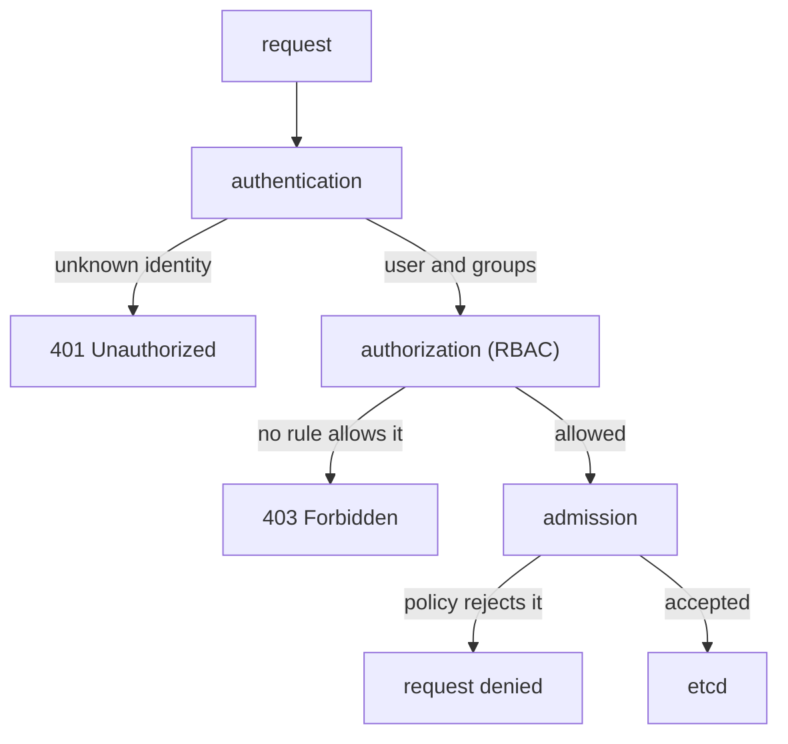

# The Request Path And Role Rules

A deploy pipeline needs to create and update Deployments in one namespace. Nothing more. Before you can give it exactly that, you need to know where in the API server the decision is made, and how a rule describes "create Deployments in `starfleet`". This part follows one request through the API server, then writes the first `Role` and `RoleBinding` and proves them.

## One request, three checks

Every call that `kubectl`, a controller or a pipeline makes is an HTTPS request to the API server. The API server handles it in a fixed order, and each step can stop it:



The diagram shows the three checks in order, each with its own way out, before an object is stored in etcd, the cluster's database.

**Authentication** finds out who sent the request: a client certificate, a service account token or another credential. The result is a user name and a list of groups. **Authorization** then decides whether that user or one of its groups may perform this verb on this resource. RBAC does this job. **Admission** comes last and only for requests that change objects; it can still reject an object, for example a pod that breaks a security policy. RBAC never sees the content of the object. It only sees who is asking, the verb, the resource and the namespace.

You can ask the API server who you are right now:

<!-- astrona:playground:renew -->

```sh
kubectl auth whoami
```

You should see something like:

```text
ATTRIBUTE                                           VALUE
Username                                            kubernetes-admin
Groups                                              [kubeadm:cluster-admins system:authenticated]
Extra: authentication.kubernetes.io/credential-id   [X509SHA256=de69993acc43a5c111ee35f71f133949f547283643859fd2748f9cdeb165d934]
```

Your `kubectl` authenticates with a client certificate (`X509`). Its user is `kubernetes-admin`, in the group `kubeadm:cluster-admins`, which the cluster binds to `cluster-admin`. That is why every command you run works. A service account is a different identity. Its user name has a fixed form: `system:serviceaccount:<namespace>:<name>`.

## A request that RBAC refuses

`kubectl` can send a request as another identity with `--as`. The API server then authorizes the request for that identity instead of yours. This is called impersonation, and your administrator identity is allowed to use it. Try to list the Deployments in `starfleet` as the `ci-deployer` service account:

```sh
kubectl -n starfleet get deployments --as=system:serviceaccount:starfleet:ci-deployer
```

You should see:

```text
Error from server (Forbidden): deployments.apps is forbidden: User "system:serviceaccount:starfleet:ci-deployer" cannot list resource "deployments" in API group "apps" in the namespace "starfleet"
```

Authentication succeeded, because the API server knows this service account. Authorization failed, because no rule gives it anything. RBAC denies by default: a request is allowed only when at least one rule allows it, and there are no rules that deny.

## What a rule describes

A rule is a list of allowed actions. It has four fields:

- `apiGroups`: the API group of the resource. Core resources such as pods, Services, ConfigMaps and Secrets are in the core group, written as `""`. Deployments are in `apps`.
- `resources`: the resource names, in plural and lower case, as the API uses them: `deployments`, `services`, `pods`.
- `verbs`: the actions: `get`, `list`, `watch`, `create`, `update`, `patch`, `delete` and `deletecollection`. `kubectl get <name>` uses `get`; `kubectl get` without a name uses `list`; `kubectl apply` uses `get`, then `create` or `patch`.
- `resourceNames`: optional. Limits the rule to objects with these names.

A **Role** is a named list of rules that is valid in one namespace. The pipeline must manage Deployments and must be able to see the Services it deploys next to them.

Save this as `role-ci-deployer.yaml`:

```yaml
apiVersion: rbac.authorization.k8s.io/v1
kind: Role
metadata:
  name: ci-deployer
  namespace: starfleet
rules:
  - apiGroups: ["apps"]
    resources: ["deployments"]
    verbs: ["get", "list", "watch", "create", "update", "patch"]
  - apiGroups: [""]
    resources: ["services"]
    verbs: ["get", "list"]
```

Apply it:

```sh
kubectl apply -f role-ci-deployer.yaml
```

The `delete` verb is missing on purpose: this pipeline never removes a Deployment, so it does not get the right to. A Role on its own gives nobody anything. It needs a binding.

## Bind the role to the service account

A **RoleBinding** gives the rules of one role to a list of subjects in the binding's namespace. A subject is a user, a group or a service account.

Save this as `rolebinding-ci-deployer.yaml`:

```yaml
apiVersion: rbac.authorization.k8s.io/v1
kind: RoleBinding
metadata:
  name: ci-deployer
  namespace: starfleet
subjects:
  - kind: ServiceAccount
    name: ci-deployer
    namespace: starfleet
roleRef:
  apiGroup: rbac.authorization.k8s.io
  kind: Role
  name: ci-deployer
```

Apply it:

```sh
kubectl apply -f rolebinding-ci-deployer.yaml
```

You should see:

```text
rolebinding.rbac.authorization.k8s.io/ci-deployer created
```

`roleRef` names the role, and `subjects` lists who gets it. A service account subject always carries its namespace, because two namespaces can each have a service account with the same name.

## Prove it with can-i

`kubectl auth can-i <verb> <resource>` asks the API server whether a request would be allowed, without making it. With `--as`, it asks for another identity. Check what the pipeline can and cannot do:

```sh
kubectl auth can-i create deployments -n starfleet --as=system:serviceaccount:starfleet:ci-deployer
kubectl auth can-i delete deployments -n starfleet --as=system:serviceaccount:starfleet:ci-deployer
kubectl auth can-i create services -n starfleet --as=system:serviceaccount:starfleet:ci-deployer
kubectl auth can-i create deployments -n outpost --as=system:serviceaccount:starfleet:ci-deployer
```

You should see:

```text
yes
no
no
no
```

Each answer matches one fact about the role: `create` on Deployments is in the rule, `delete` is not, Services allow only `get` and `list`, and the binding lives in `starfleet`, so `outpost` gets nothing. The command also sets its exit code: `0` for `yes` and `1` for `no`, so a script can use it as a check. The earlier request now works, too: `kubectl -n starfleet get deployments --as=system:serviceaccount:starfleet:ci-deployer` lists `probe`, `scout` and `shuttle`.

You now know where RBAC sits in the request path and what it can see: the identity, the verb, the resource and the namespace, never the object's content. You wrote a Role with exactly the verbs a pipeline needs and bound it to one service account in one namespace. The open question is what changes when the subject is a person or a group, or when the rights must reach more than one namespace.

## Common pitfalls

> [!WARNING]
> - **Writing the wrong API group.** Deployments are in `apps`, not in the core group `""`. A rule with the wrong group matches nothing, and RBAC does not warn you.
> - **Forgetting `list` and `watch`.** `get` reads one named object. `kubectl get deployments` needs `list`, and most controllers and `kubectl rollout status` also need `watch`.
> - **Creating a Role and expecting it to work.** A Role gives nothing until a RoleBinding names it.
> - **Giving a ServiceAccount subject the wrong namespace.** The binding then grants the rights to a service account of the same name in that other namespace, and the request from the real one stays forbidden.
