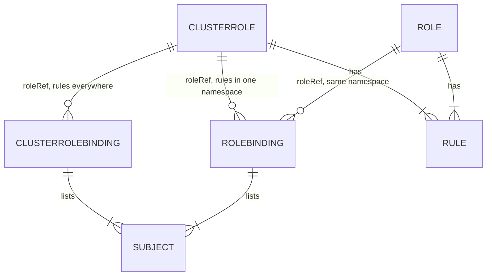

# Bindings, Subjects And Scope

A pipeline is one service account in one namespace. People are different: a team of developers should read what runs in their namespace, and some tools need to see objects that do not live in any namespace at all. This part looks at the three kinds of subject a binding can name, and at the two questions that decide the scope of every grant: is the role a `Role` or a `ClusterRole`, and is the binding a `RoleBinding` or a `ClusterRoleBinding`?

## Users, groups and service accounts

A binding's `subjects` can name three kinds of identity:

- `kind: User` with a `name`. Kubernetes has no user objects. A user is whatever name the authenticator reports, for example the common name of a client certificate or a name from an identity provider.
- `kind: Group` with a `name`. A group is also only a name that the authenticator reports, for example the organization field of a certificate. Binding a group is the usual way to give a whole team the same rights.
- `kind: ServiceAccount` with a `name` and a `namespace`. Service accounts are real objects, and pods use them.

Because users and groups are only names, RBAC accepts a binding to a name that no one has yet. It also means `kubectl --as` can check a person's rights before that person ever logs in. `--as` sets the user name and `--as-group` sets a group.

The developer `dev-anna` will log in with a certificate that puts the user in the group `developers`. Check what `dev-anna` can do today:

<!-- astrona:playground:renew -->

```sh
kubectl auth can-i list pods -n starfleet --as=dev-anna --as-group=developers
```

You should see:

```text
no
```

## A ClusterRole used in one namespace

Writing a read-only role from scratch means listing dozens of resources. Kubernetes ships ready-made ones instead. A **ClusterRole** is a role that is not tied to a namespace. The built-in ClusterRoles `view`, `edit` and `admin` describe common levels of access, and `cluster-admin` allows everything.

A ClusterRole can be used by either kind of binding. A **RoleBinding** that points at a ClusterRole gives its rules **only in the binding's namespace**. This is the normal way to reuse one role definition in many namespaces.

Save this as `rolebinding-developers-view.yaml`:

```yaml
apiVersion: rbac.authorization.k8s.io/v1
kind: RoleBinding
metadata:
  name: developers-view
  namespace: starfleet
subjects:
  - kind: Group
    name: developers
    apiGroup: rbac.authorization.k8s.io
roleRef:
  apiGroup: rbac.authorization.k8s.io
  kind: ClusterRole
  name: view
```

Apply it:

```sh
kubectl apply -f rolebinding-developers-view.yaml
```

Then check the result from several sides:

```sh
kubectl auth can-i list pods -n starfleet --as=dev-anna --as-group=developers
kubectl auth can-i list pods -n outpost --as=dev-anna --as-group=developers
kubectl auth can-i list pods -n starfleet --as=dev-anna
kubectl auth can-i get secrets -n starfleet --as=dev-anna --as-group=developers
kubectl auth can-i delete pods -n starfleet --as=dev-anna --as-group=developers
```

You should see:

```text
yes
no
no
no
no
```

The first answer is the grant working. The second shows the scope: the binding lives in `starfleet`, so `outpost` gets nothing, although `view` is a ClusterRole. The third shows that the right comes from the group: the same user without the group gets nothing. The last two show what `view` leaves out on purpose: it never reads Secrets, because a Secret often holds a token that would give more access, and it never changes anything.

`kubectl get rolebindings -o wide` shows each binding with its role and subjects in one table:

```sh
kubectl -n starfleet get rolebindings -o wide
```

You should see something like:

```text
NAME              ROLE               AGE   USERS   GROUPS       SERVICEACCOUNTS
ci-deployer       Role/ci-deployer   19s                        starfleet/ci-deployer
developers-view   ClusterRole/view   0s            developers   
```

## Rights outside any namespace

Some resources have no namespace: nodes, namespaces themselves, PersistentVolumes, ClusterRoles. A RoleBinding cannot give access to them, because a RoleBinding only ever works inside its own namespace. For those, you need a **ClusterRoleBinding**, which gives a ClusterRole's rules in every namespace and on cluster-wide resources.

The developers should be able to list the namespaces of the cluster. That needs a small ClusterRole and a ClusterRoleBinding.

Save this as `clusterrole-namespace-reader.yaml`:

```yaml
apiVersion: rbac.authorization.k8s.io/v1
kind: ClusterRole
metadata:
  name: namespace-reader
rules:
  - apiGroups: [""]
    resources: ["namespaces"]
    verbs: ["get", "list"]
```

Save this as `clusterrolebinding-developers-namespace-reader.yaml`:

```yaml
apiVersion: rbac.authorization.k8s.io/v1
kind: ClusterRoleBinding
metadata:
  name: developers-namespace-reader
subjects:
  - kind: Group
    name: developers
    apiGroup: rbac.authorization.k8s.io
roleRef:
  apiGroup: rbac.authorization.k8s.io
  kind: ClusterRole
  name: namespace-reader
```

Apply both, then list the namespaces as `dev-anna`:

```sh
kubectl apply -f clusterrole-namespace-reader.yaml -f clusterrolebinding-developers-namespace-reader.yaml
kubectl get namespaces --as=dev-anna --as-group=developers
```

You should see something like:

```text
clusterrole.rbac.authorization.k8s.io/namespace-reader created
clusterrolebinding.rbac.authorization.k8s.io/developers-namespace-reader created
NAME                 STATUS   AGE
default              Active   65s
kube-node-lease      Active   65s
kube-public          Active   65s
kube-system          Active   65s
local-path-storage   Active   60s
outpost              Active   43s
starfleet            Active   43s
```

The same ClusterRole bound with a RoleBinding would not work for this. Bound with a RoleBinding in `outpost` to a user `dev-bob`, the list request fails with `User "dev-bob" cannot list resource "namespaces" in API group "" at the cluster scope`. The words `at the cluster scope` mean the request was for a cluster-wide resource, which no RoleBinding can grant.

## The four combinations

The kind of role and the kind of binding together decide what a subject gets and where:



The diagram shows that each binding lists one or more subjects and points at exactly one role, that one role can be used by many bindings, and that a ClusterRoleBinding can only point at a ClusterRole. A ClusterRoleBinding to a namespaced `Role` is not possible.

In short, use this table to pick the pair:

| Requirement | Role kind | Binding kind |
| --- | --- | --- |
| Rights in one namespace, defined for that namespace | `Role` | `RoleBinding` |
| The same rights in several chosen namespaces | `ClusterRole` | one `RoleBinding` per namespace |
| Rights in every namespace, or on cluster-wide resources | `ClusterRole` | `ClusterRoleBinding` |

One more rule matters when you fix a binding: `roleRef` cannot change. To point a binding at another role, delete the binding and create it again. Trying to change it fails:

```text
The RoleBinding "developers-view" is invalid: roleRef: Invalid value: {"APIGroup":"rbac.authorization.k8s.io","Kind":"ClusterRole","Name":"edit"}: cannot change roleRef
```

You can now give a right to a service account, a user or a whole group, and you can choose its scope by the pair of role kind and binding kind. A ClusterRole defines rules once; the binding decides where they apply. The open question is how to check quickly what any identity can do, and how to read the exact reason when a request is refused.

## Common pitfalls

> [!WARNING]
> - **Using a ClusterRoleBinding to reuse a ClusterRole in one namespace.** It grants the rules in every namespace. Use a RoleBinding in each namespace instead.
> - **Expecting a RoleBinding to grant access to nodes or namespaces.** Cluster-wide resources need a ClusterRoleBinding.
> - **Binding a person's user name instead of the team's group.** Every new team member then needs a new binding. Bind the group.
> - **Editing `roleRef` in place.** It cannot change. Delete the binding and create a new one.
