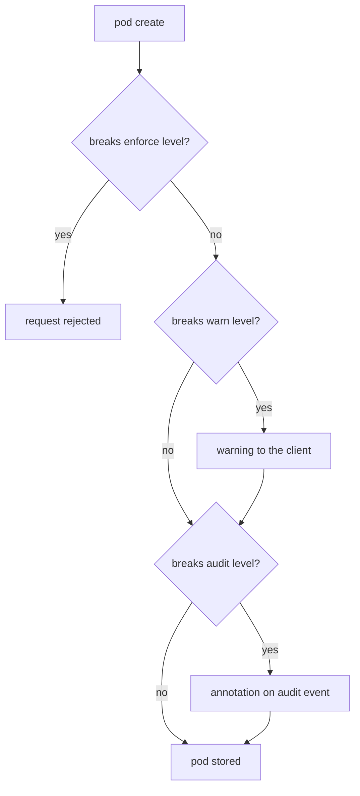

# Levels, Modes And Rejections

A pod spec has dozens of fields that change how much the container can do on its node: run as root, share the node's network, mount any host path, gain Linux capabilities, turn off isolation completely. Nobody wants to review each of them by hand for every workload. The Pod Security Standards group them into three levels, and Pod Security Admission checks the levels for you. This part explains the levels and the modes, and reads the rejection that one namespace in the playground already produces.

## Three levels

The **Pod Security Standards** are three levels defined by the Kubernetes project. Each one is a fixed list of checks on pod fields:

- `privileged` allows everything. It is for system components such as network plugins that really need full access to the node.
- `baseline` blocks the settings that are known to break isolation: privileged containers, `hostPath` volumes, host networking and host PID, added dangerous capabilities, and a few more. Most ordinary applications pass it without any change.
- `restricted` adds hardening on top of `baseline`. Every container must not allow privilege escalation, must drop all Linux capabilities, must run as a non-root user, and must use a seccomp profile. Most applications need a `securityContext` to pass it.

The levels are cumulative: a pod that passes `restricted` also passes `baseline`.

## Three modes

**Pod Security Admission** is the admission controller that applies the levels. It reads labels on each namespace. A label names a mode and a level, for example `pod-security.kubernetes.io/enforce: baseline`. There are three modes, and a namespace can use all three at once with different levels:



The diagram shows that only `enforce` stops a pod; `warn` and `audit` let it through and only report.

- `enforce` rejects a pod that breaks the level. This is the only mode that blocks anything.
- `warn` accepts the pod and returns a warning to the client, which `kubectl` prints. It also warns when you create or change a Deployment or another workload whose pod template breaks the level.
- `audit` accepts the pod and adds an annotation to the event in the API server's audit log, if audit logging is on. Nothing appears in your terminal.

## Read the labels and a rejection

Look at the labels of the two namespaces:

<!-- astrona:playground:renew -->

```sh
kubectl get namespaces starfleet outpost --show-labels
```

You should see something like:

```text
NAME        STATUS   AGE   LABELS
starfleet   Active   49s   kubernetes.io/metadata.name=starfleet
outpost     Active   49s   kubernetes.io/metadata.name=outpost,pod-security.kubernetes.io/enforce=baseline
```

`starfleet` has no Pod Security labels, so nothing is checked there. That is why `privileged-debug` runs. `outpost` enforces `baseline`. Try to create a privileged pod there.

Save this as `pod-privileged-test.yaml`:

```yaml
apiVersion: v1
kind: Pod
metadata:
  name: privileged-test
  namespace: outpost
spec:
  containers:
    - name: test
      image: curlimages/curl:8.22.0
      command: ["sh", "-c", "sleep 3600"]
      securityContext:
        privileged: true
```

Apply it:

```sh
kubectl apply -f pod-privileged-test.yaml
```

You should see:

```text
Error from server (Forbidden): error when creating "pod-privileged-test.yaml": pods "privileged-test" is forbidden: violates PodSecurity "baseline:latest": privileged (container "test" must not set securityContext.privileged=true)
```

The message has three parts worth reading. `violates PodSecurity` names the component that refused the pod: Pod Security Admission, not RBAC. `"baseline:latest"` is the level and the version of the checks; `latest` means the checks of the cluster's own Kubernetes version. The rest lists each failed check, with the container and the exact field: `privileged (container "test" must not set securityContext.privileged=true)`. Each item maps to one field you must change.

The pod was rejected even though you are the cluster administrator. Pod Security Admission does not care who sends the request. RBAC answered "yes, you may create pods", and admission answered "not this pod".

You now know the three levels, what each mode does with a pod that breaks it, and how to read a rejection down to the field. The open question is how to raise the level of a namespace like `starfleet`, which already runs pods that would break it, without stopping them by surprise.

## Common pitfalls

> [!WARNING]
> - **Expecting `warn` or `audit` to block anything.** Only `enforce` rejects pods.
> - **Reading `Forbidden` as an RBAC problem.** When the message says `violates PodSecurity`, the request passed RBAC and admission refused the pod's content.
> - **Thinking an administrator is exempt.** Pod Security Admission checks the pod, not the user. Exemptions exist only in the API server's own configuration.
> - **Assuming `privileged` is a safe default.** A namespace with no labels behaves like `privileged`: nothing is checked.
