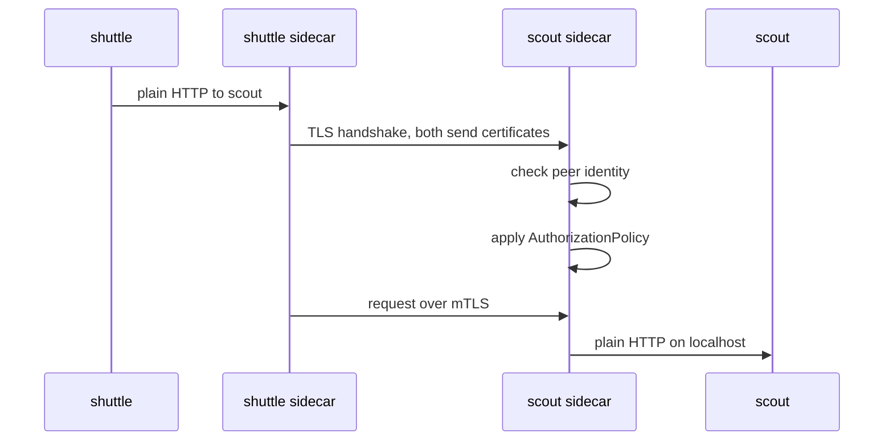

# Mesh Identity And mTLS Modes

Every security decision in a mesh starts with one question: who is calling? Istio answers it with a certificate, not with an IP address. This part shows where that certificate lives, what identity it carries and where the identity comes from. It ends with the reason the playground mesh still accepts plain text from `drifter`.

## The sidecar

Look at the pods in `starfleet`:

<!-- astrona:playground:renew -->

```sh
kubectl -n starfleet get pods
```

You should see something like:

```text
NAME                       READY   STATUS    RESTARTS   AGE
probe-6f569ff97-qdzc5      2/2     Running   0          21s
scout-64445474d5-gvvck     2/2     Running   0          21s
shuttle-75fc875874-bkkrh   2/2     Running   0          21s
```

Each pod has two containers, but the Deployments define only one. The second one is the **sidecar proxy**: an Envoy proxy container that Istio adds to each pod, so that all inbound and outbound traffic of the pod passes through it. **Sidecar injection** adds it. The API server calls Istio's mutating admission webhook when a pod is created in a namespace labelled `istio-injection=enabled`, and the webhook changes the pod spec before it is stored.

List the containers of the `scout` pod:

```sh
kubectl -n starfleet get pod -l app=scout -o jsonpath='{.items[0].spec.initContainers[*].name}{" | "}{.items[0].spec.containers[*].name}{"\n"}'
```

You should see:

```text
istio-init istio-proxy | scout
```

On Kubernetes 1.33 and later, `istio-proxy` is a native sidecar: it is listed under `initContainers` with a restart policy that keeps it running for the whole life of the pod. `istio-init` runs first and sets up the network rules that send the pod's traffic through the proxy. The application container `scout` is unchanged and knows nothing about the mesh.

## The workload certificate

`istiod`, Istio's control plane, runs a certificate authority. When a sidecar starts, it proves its service account to `istiod` with the pod's service account token, and gets back a short-lived certificate. `istioctl proxy-config secret` shows the certificates one proxy holds:

```sh
istioctl proxy-config secret deploy/scout -n starfleet
```

You should see something like:

```text
RESOURCE NAME     TYPE           STATUS     VALID CERT     SERIAL NUMBER                        NOT AFTER                NOT BEFORE
default           Cert Chain     ACTIVE     true           b53bbd6f59df0008fd584d6922cdfb1d     2026-10-11T15:36:11Z     2026-10-10T15:34:11Z
ROOTCA            CA             ACTIVE     true           bb8e8a18f5606843faa0703c50267e8e     2036-10-07T15:36:06Z     2026-10-10T15:36:06Z
```

`default` is the workload's own certificate, valid for 24 hours; the sidecar renews it on its own before it expires. `ROOTCA` is the root certificate that every proxy in the mesh trusts. The identity is inside `default`. Pull it out and print its subject alternative name:

```sh
istioctl proxy-config secret deploy/scout -n starfleet -o json \
  | jq -r '.dynamicActiveSecrets[] | select(.name=="default") | .secret.tlsCertificate.certificateChain.inlineBytes' \
  | base64 -d | openssl x509 -noout -ext subjectAltName
```

You should see:

```text
X509v3 Subject Alternative Name: critical
    URI:spiffe://cluster.local/ns/starfleet/sa/scout
```

That URI is the workload's **SPIFFE identity**: `spiffe://<trust domain>/ns/<namespace>/sa/<service account>`. The trust domain is `cluster.local` by default. The identity comes from the namespace and the service account, and from nothing else. Every pod of `scout` has the same identity, and a pod of another Deployment that uses the `scout` service account would have it too. That is why each workload here runs on its own service account.

Authorization policies write the same identity without the `spiffe://` prefix, as a **principal**: `cluster.local/ns/starfleet/sa/scout`.

## Mutual TLS between sidecars

When `shuttle` sends a request to `scout`, the two sidecars handle the connection:



The diagram shows the application sending plain HTTP to its own sidecar, the two sidecars authenticating each other with their certificates, and the receiving sidecar checking the caller's identity and the policies before it passes the request on.

This is **mutual TLS (mTLS)**: both sides present a certificate, so each side proves its identity and the traffic between the pods is encrypted. The applications never handle a certificate.

## Why plain text still works

`drifter` in `outpost` has no sidecar. Send a request from it to `scout`:

```sh
kubectl -n outpost exec deploy/drifter -- curl -s -o /dev/null -w '%{http_code}\n' http://scout.starfleet
```

You should see:

```text
200
```

The request arrived in plain text, and `scout`'s sidecar accepted it. That is Istio's default mode, **PERMISSIVE**: a sidecar accepts both mTLS and plain text on the same port. It exists so that you can add workloads to the mesh one at a time without breaking the clients that are not in it yet. `istioctl x describe pod` shows the mode that applies to a pod:

```sh
istioctl x describe pod $(kubectl -n starfleet get pod -l app=scout -o jsonpath='{.items[0].metadata.name}') -n starfleet
```

You should see something like:

```text
Pod: scout-64445474d5-gvvck
   Pod Revision: default
   Pod Ports: 9898 (scout)
--------------------
Service: scout
   Port: http 80/HTTP targets pod port 9898
--------------------
Effective PeerAuthentication:
   Workload mTLS mode: PERMISSIVE
Skipping Gateway information (no ingress gateway pods)
```

You now know where the sidecar and its certificate come from, how to read the SPIFFE identity in that certificate, and why the mesh accepts plain text at the start. Between two sidecars the traffic already uses mTLS, but nothing yet stops a client without one. The open question is how to require mTLS, and what breaks when you do.

## Common pitfalls

> [!WARNING]
> - **Thinking the identity comes from the pod or the Deployment.** It comes only from the namespace and the service account. Workloads that share a service account cannot be told apart by policy.
> - **Using the `default` service account for every workload.** Then every workload in the namespace has the same identity.
> - **Expecting the mesh to block plain text out of the box.** The default mode is PERMISSIVE.
> - **Looking for `istio-proxy` only under `containers`.** On Kubernetes 1.33 and later it is a native sidecar under `initContainers`; `READY` still shows `2/2`.
