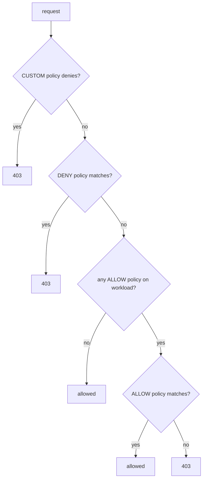

# Authorizing Callers

STRICT mTLS proves who is calling. It does not limit who may call. `scout` should answer `GET` requests from `shuttle` and nothing else, and some paths should be closed to everyone. Istio's AuthorizationPolicy does that job inside the receiving sidecar, with the caller's verified identity. This part writes an ALLOW policy, reads the answer a refused caller gets, and works out what happens when several policies match the same request.

## An ALLOW policy

An **AuthorizationPolicy** is the Istio resource that allows or denies requests to a workload by source identity, namespace, method or path. Its main fields are:

- `selector`: which pods the policy protects, by label. Without a selector, it protects every pod in the namespace.
- `action`: `ALLOW`, `DENY`, `CUSTOM` (ask an external service) or `AUDIT`.
- `rules`: a list. A request matches the policy if it matches any one rule. Inside a rule, `from` (who), `to` (what) and `when` (extra conditions) must all match.

`from.source.principals` takes the caller's identity in principal form. Allow `shuttle` to send `GET` requests to `scout`.

<!-- astrona:playground:renew -->

Save this as `authorizationpolicy-scout-allow-shuttle.yaml`:

```yaml
apiVersion: security.istio.io/v1
kind: AuthorizationPolicy
metadata:
  name: scout-allow-shuttle
  namespace: starfleet
spec:
  selector:
    matchLabels:
      app: scout
  action: ALLOW
  rules:
    - from:
        - source:
            principals: ["cluster.local/ns/starfleet/sa/shuttle"]
      to:
        - operation:
            methods: ["GET"]
```

Apply it:

```sh
kubectl apply -f authorizationpolicy-scout-allow-shuttle.yaml
```

Once a workload has at least one ALLOW policy, a request is allowed only if an ALLOW policy matches it. Everything else is denied.

## Read the 403

Send a `GET` and a `POST` from `shuttle`:

```sh
kubectl -n starfleet exec deploy/shuttle -c shuttle -- curl -s -o /dev/null -w '%{http_code}\n' http://scout.starfleet
kubectl -n starfleet exec deploy/shuttle -c shuttle -- curl -s -w '\n%{http_code}\n' -X POST http://scout.starfleet/echo -d hi
```

You should see:

```text
200
RBAC: access denied
403
```

The `GET` matches the rule. The `POST` does not, and `scout`'s sidecar answered with `403` and the body `RBAC: access denied`. That body comes from Envoy, not from the application: Envoy calls its authorization filter "RBAC". It does not mean Kubernetes RBAC refused anything.

Now call `scout` from another identity. Start a temporary client pod in `starfleet` that runs as the `probe` service account; it gets a sidecar like every pod in the namespace:

```sh
kubectl -n starfleet run caller --image=curlimages/curl:8.22.0 --overrides='{"spec":{"serviceAccountName":"probe"}}' --command -- sleep 3600
kubectl -n starfleet wait --for=condition=Ready pod/caller
kubectl -n starfleet exec caller -c caller -- curl -s -w '\n%{http_code}\n' http://scout.starfleet
```

You should see:

```text
pod/caller created
pod/caller condition met
RBAC: access denied
403
```

The connection used mTLS, so `scout`'s sidecar knew the caller was `cluster.local/ns/starfleet/sa/probe`. No ALLOW rule names that principal, so the request was denied.

To see which policies apply to a workload, ask `istioctl`:

```sh
istioctl x authz check deploy/scout -n starfleet
```

You should see:

```text
ACTION   AuthorizationPolicy             RULES
ALLOW    _anonymous_match_nothing_       1
ALLOW    scout-allow-shuttle.starfleet   1
```

The list shows each policy by `name.namespace`, its action and its number of rules. `_anonymous_match_nothing_` is an entry that Istio generates; it does not come from any policy you wrote. When a request is denied and you want to know why, this list is the first place to look: a `403` with only ALLOW policies means no rule matched.

## Which policy wins

A workload can have several policies with different actions. The sidecar checks them in a fixed order:



The diagram shows that CUSTOM and DENY are checked before ALLOW, so a matching DENY always wins, and that a workload without ALLOW policies allows everything that was not denied.

Test it with a DENY policy that closes the `/env` path of `scout`, which prints the container's environment variables, for every caller. `shuttle` is allowed to send `GET` requests by the ALLOW policy.

Save this as `authorizationpolicy-scout-deny-env.yaml`:

```yaml
apiVersion: security.istio.io/v1
kind: AuthorizationPolicy
metadata:
  name: scout-deny-env
  namespace: starfleet
spec:
  selector:
    matchLabels:
      app: scout
  action: DENY
  rules:
    - to:
        - operation:
            paths: ["/env"]
```

Apply it:

```sh
kubectl apply -f authorizationpolicy-scout-deny-env.yaml
```

You should see:

```text
Warning: configured AuthorizationPolicy will deny all traffic to TCP ports under its scope due to the use of only HTTP attributes in a DENY rule; it is recommended to explicitly specify the port
authorizationpolicy.security.istio.io/scout-deny-env created
```

The warning matters on workloads that also serve plain TCP: a DENY rule that uses HTTP fields such as `paths` matches every TCP connection, because Istio cannot read a path from raw TCP. `scout` serves only HTTP, so it is safe here. Wait a few seconds, then send a `GET` to `/env` and to `/` from `shuttle`:

```sh
kubectl -n starfleet exec deploy/shuttle -c shuttle -- curl -s -o /dev/null -w '%{http_code}\n' http://scout.starfleet/env
kubectl -n starfleet exec deploy/shuttle -c shuttle -- curl -s -o /dev/null -w '%{http_code}\n' http://scout.starfleet/
```

You should see:

```text
403
200
```

The ALLOW policy matches both requests, and the DENY policy matches only `/env`. DENY is checked first, so `/env` is refused. Path matching is exact unless you add `*` at the start or end: a request to `/env/` does not match `/env`, and `podinfo` answers it with `404`, not `403`. Use `paths: ["/env", "/env/*"]` to close a path and everything under it.

## Default deny for a namespace

An AuthorizationPolicy with an empty `spec` selects every workload in its namespace, has the action `ALLOW`, and has no rules, so it matches nothing. Every workload then has an ALLOW policy that never matches, and every request is denied until another ALLOW policy allows it. This is the **default-deny** pattern.

Save this as `authorizationpolicy-starfleet-allow-nothing.yaml`:

```yaml
apiVersion: security.istio.io/v1
kind: AuthorizationPolicy
metadata:
  name: allow-nothing
  namespace: starfleet
spec: {}
```

Apply it, wait a few seconds, then call `probe`, which has no other policy, and `scout`, which has its own ALLOW policy:

```sh
kubectl apply -f authorizationpolicy-starfleet-allow-nothing.yaml
kubectl -n starfleet exec deploy/shuttle -c shuttle -- curl -s -o /dev/null -w '%{http_code}\n' http://probe.starfleet/get
kubectl -n starfleet exec deploy/shuttle -c shuttle -- curl -s -o /dev/null -w '%{http_code}\n' http://scout.starfleet/
```

You should see:

```text
403
200
```

`probe` now refuses everyone, because the only ALLOW policy that selects it matches nothing. `scout` still answers `shuttle`, because its own ALLOW policy matches. With default deny in place, every new workload in `starfleet` is closed until someone writes the policy that opens it.

You can now allow one identity and one method on one workload, read an Envoy `403` and list the policies behind it, predict the result when DENY and ALLOW policies overlap, and close a whole namespace by default. Together with STRICT mTLS, every request into `starfleet` has a proven identity and an explicit permission.

## Common pitfalls

> [!WARNING]
> - **Reading `RBAC: access denied` as Kubernetes RBAC.** It is Envoy's authorization filter in the receiving sidecar, driven by AuthorizationPolicy.
> - **Using principals without STRICT mTLS.** A plain-text request has no principal, so a `principals` rule cannot match it; require mTLS first.
> - **Writing `spiffe://` in `principals`.** The field takes `cluster.local/ns/<namespace>/sa/<name>`, without the prefix.
> - **Expecting an ALLOW policy to beat a DENY policy.** DENY is checked first and always wins.
> - **Adding the first ALLOW policy to a busy workload.** From that moment, every request it does not match is denied.
