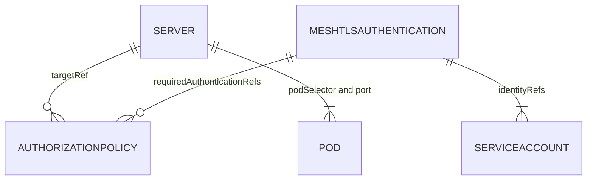

# Servers And Authorization Policies

The default inbound policy is a blunt tool: it treats every caller the same. To let `shuttle` call `scout` and refuse every other identity, Linkerd uses three resources that each do one job. This part builds them one at a time and proves each step from three callers: `shuttle`, `drifter` and a meshed pod that runs as another service account.

## Three resources, three jobs

Linkerd's policy resources live in the `policy.linkerd.io` API group. In Linkerd edge-26.10.1, `kubectl api-resources --api-group=policy.linkerd.io` lists `Server` at `v1beta3`, and `AuthorizationPolicy` and `MeshTLSAuthentication` at `v1alpha1`:

- A **Server** selects a port on a set of pods. It answers "which door?".
- A **MeshTLSAuthentication** names the mesh identities a policy accepts, as service accounts or identity strings. It answers "who?".
- An **AuthorizationPolicy** connects a target (a Server) with the authentications a caller must pass. It answers "who may use which door?".



The diagram shows that an AuthorizationPolicy points at one Server and at one or more authentications, that a MeshTLSAuthentication names service accounts, and that a Server selects a port on pods.

## A Server closes the door

Create the Server for `scout`'s HTTP port first. `port` takes the container port's name or number, and `proxyProtocol` tells the proxy which protocol to expect.

<!-- astrona:playground:renew -->

Save this as `server-scout-http.yaml`:

```yaml
apiVersion: policy.linkerd.io/v1beta3
kind: Server
metadata:
  name: scout-http
  namespace: starfleet
spec:
  podSelector:
    matchLabels:
      app: scout
  port: http
  proxyProtocol: HTTP/1
```

Apply it and look at it:

```sh
kubectl apply -f server-scout-http.yaml
kubectl -n starfleet get servers
```

You should see:

```text
server.policy.linkerd.io/scout-http created
NAME         PORT   PROTOCOL   ACCESS POLICY
scout-http   http   HTTP/1     deny
```

The `ACCESS POLICY` column says `deny`. Once a Server selects a port, the default inbound policy no longer applies to that port: only AuthorizationPolicies that target the Server can allow traffic, and there are none yet. Wait a few seconds and send a request from `shuttle`:

```sh
kubectl -n starfleet exec deploy/shuttle -c shuttle -- curl -s -w '\n%{http_code}\n' http://scout.starfleet
```

You should see:

```text

403
```

Even `shuttle`, with a valid identity, is refused now. A Server on its own locks the port.

## Allow one identity

Name the allowed identity with a MeshTLSAuthentication. `identityRefs` points at the `shuttle` service account, so you do not have to write the long identity string.

Save this as `meshtlsauthentication-shuttle.yaml`:

```yaml
apiVersion: policy.linkerd.io/v1alpha1
kind: MeshTLSAuthentication
metadata:
  name: shuttle
  namespace: starfleet
spec:
  identityRefs:
    - kind: ServiceAccount
      name: shuttle
```

Then connect the Server and the authentication with an AuthorizationPolicy.

Save this as `authorizationpolicy-scout-allow-shuttle.yaml`:

```yaml
apiVersion: policy.linkerd.io/v1alpha1
kind: AuthorizationPolicy
metadata:
  name: scout-allow-shuttle
  namespace: starfleet
spec:
  targetRef:
    group: policy.linkerd.io
    kind: Server
    name: scout-http
  requiredAuthenticationRefs:
    - group: policy.linkerd.io
      kind: MeshTLSAuthentication
      name: shuttle
```

Apply both:

```sh
kubectl apply -f meshtlsauthentication-shuttle.yaml -f authorizationpolicy-scout-allow-shuttle.yaml
```

## Prove it from three callers

Wait a few seconds, then send a request from `shuttle` and from `drifter`. Then start a temporary meshed client that runs as the `probe` service account and send one from there:

```sh
kubectl -n starfleet exec deploy/shuttle -c shuttle -- curl -s -o /dev/null -w '%{http_code}\n' http://scout.starfleet
kubectl -n outpost exec deploy/drifter -- curl -s -o /dev/null -w '%{http_code}\n' http://scout.starfleet
kubectl -n starfleet run caller --image=curlimages/curl:8.22.0 --overrides='{"spec":{"serviceAccountName":"probe"}}' --command -- sleep 3600
kubectl -n starfleet wait --for=condition=Ready pod/caller
kubectl -n starfleet exec caller -c caller -- curl -s -o /dev/null -w '%{http_code}\n' http://scout.starfleet
```

You should see:

```text
200
403
pod/caller created
pod/caller condition met
403
```

`shuttle` matches the MeshTLSAuthentication and is allowed. `drifter` has no identity at all. `caller` is meshed and has a valid identity, `probe.starfleet.serviceaccount.identity.linkerd.cluster.local`, but it is not the one the policy names. Both are refused with `403`.

## Linkerd and Istio side by side

Both meshes do the same jobs with different resources. When an exam task names one mesh, this table tells you what to reach for:

| Job | Istio | Linkerd |
| --- | --- | --- |
| Add the proxy to pods | Label `istio-injection=enabled` | Annotation `linkerd.io/inject: enabled` |
| Workload identity | `spiffe://cluster.local/ns/<ns>/sa/<sa>` | `<sa>.<ns>.serviceaccount.identity.linkerd.cluster.local` |
| Require mTLS from callers | PeerAuthentication `STRICT` | Default inbound policy `all-authenticated`, or a Server with AuthorizationPolicies |
| Select what is protected | AuthorizationPolicy `selector` | Server `podSelector` and `port` |
| Name allowed callers | `from.source.principals` | MeshTLSAuthentication `identityRefs` |
| Allow the request | AuthorizationPolicy `action: ALLOW` | AuthorizationPolicy `targetRef` plus `requiredAuthenticationRefs` |
| Refused request | `403` with `RBAC: access denied` | `403` with an empty body |

You can now lock a port with a Server, allow exactly one identity through it with a MeshTLSAuthentication and an AuthorizationPolicy, and prove the result from a meshed caller, a wrong identity and a client without a proxy. You can also translate each step to Istio and back.

## Common pitfalls

> [!WARNING]
> - **Creating a Server and nothing else.** The port is then closed to everyone, including callers the default policy allowed a minute ago.
> - **Pointing `port` at the Service port instead of the container port.** A Server selects the pod's port (`http`, `9898` here), not the Service's `80`.
> - **Using the wrong API version.** In edge-26.10.1, `Server` is `v1beta3`; `AuthorizationPolicy` and `MeshTLSAuthentication` are `v1alpha1`. Check with `kubectl api-resources --api-group=policy.linkerd.io`.
> - **Confusing Linkerd's and Istio's AuthorizationPolicy.** They share a name but not an API group or fields: `policy.linkerd.io` versus `security.istio.io`.
