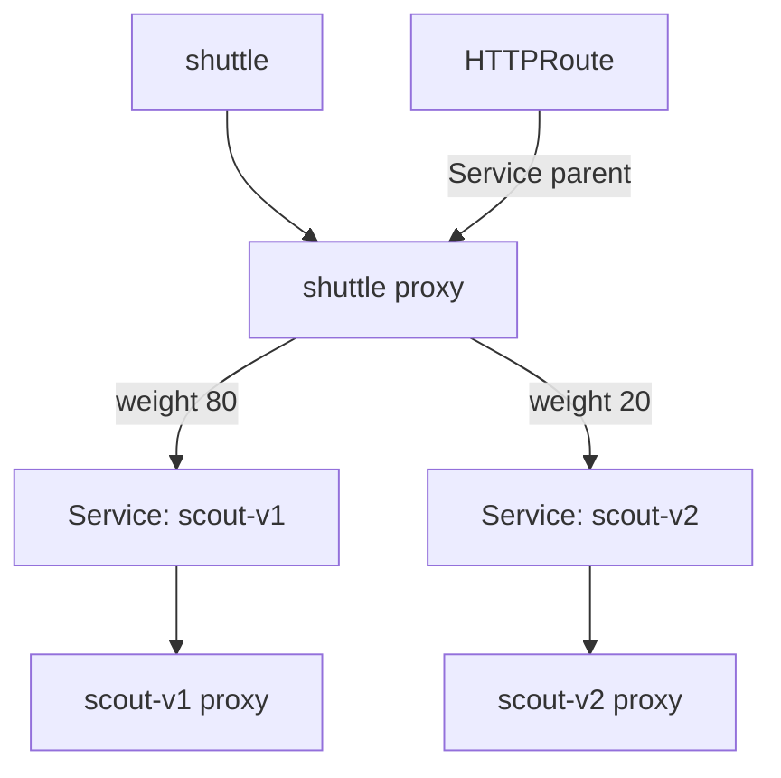

# Repair Authorization And Split Service Traffic

A release needs more than two running versions. The `shuttle` client must be allowed to call both backends, and most requests must keep reaching the established version. Use a `Server` to select each workload's inbound port, an `AuthorizationPolicy` to permit the client, and an `HTTPRoute` to divide requests between the two backend Services. A Service gives clients a stable network address; an HTTPRoute defines how proxies match and forward Hypertext Transfer Protocol (HTTP) requests.

## Prepare two independent backends

The playground has a meshed `shuttle` client in `starfleet`. A meshed pod has a Linkerd proxy that handles its network traffic. Create `scout-v1` and `scout-v2` as two release versions; both use the pinned podinfo image, and their pod names identify which version answered. A Deployment keeps the requested number of application pods running. Each workload has its own service account, the Kubernetes identity assigned to its pods.

<!-- astrona:playground:renew -->

Save this as `deployments-scout-versions.yaml`:

```yaml
apiVersion: v1
kind: ServiceAccount
metadata: {name: scout-v1, namespace: starfleet}
---
apiVersion: v1
kind: ServiceAccount
metadata: {name: scout-v2, namespace: starfleet}
---
apiVersion: apps/v1
kind: Deployment
metadata: {name: scout-v1, namespace: starfleet}
spec:
  replicas: 1
  selector:
    matchLabels: {app: scout-release, version: v1}
  template:
    metadata:
      labels: {app: scout-release, version: v1}
    spec:
      serviceAccountName: scout-v1
      containers:
        - name: scout
          image: ghcr.io/stefanprodan/podinfo:6.15.0
          ports: [{name: http, containerPort: 9898}]
          resources:
            requests: {cpu: 10m, memory: 32Mi}
            limits: {memory: 64Mi}
---
apiVersion: apps/v1
kind: Deployment
metadata: {name: scout-v2, namespace: starfleet}
spec:
  replicas: 1
  selector:
    matchLabels: {app: scout-release, version: v2}
  template:
    metadata:
      labels: {app: scout-release, version: v2}
    spec:
      serviceAccountName: scout-v2
      containers:
        - name: scout
          image: ghcr.io/stefanprodan/podinfo:6.15.0
          ports: [{name: http, containerPort: 9898}]
          resources:
            requests: {cpu: 10m, memory: 32Mi}
            limits: {memory: 64Mi}
---
apiVersion: v1
kind: Service
metadata: {name: scout-v1, namespace: starfleet}
spec:
  selector: {app: scout-release, version: v1}
  ports: [{name: http, port: 80, targetPort: http}]
---
apiVersion: v1
kind: Service
metadata: {name: scout-v2, namespace: starfleet}
spec:
  selector: {app: scout-release, version: v2}
  ports: [{name: http, port: 80, targetPort: http}]
---
apiVersion: v1
kind: Service
metadata: {name: scout-release, namespace: starfleet}
spec:
  selector: {app: scout-release, version: v1}
  ports: [{name: http, port: 80, targetPort: http}]
```

Apply it:

```sh
kubectl apply -f deployments-scout-versions.yaml
```

Then check the result:

```sh
kubectl -n starfleet rollout status deploy/scout-v1 --timeout=180s
kubectl -n starfleet rollout status deploy/scout-v2 --timeout=180s
kubectl -n starfleet get pods -l app=scout-release
```

Look for ready application containers and Linkerd proxies. The namespace's injection annotation adds the proxies when Kubernetes creates the pods. Each versioned Service selects just one version. The parent Service `scout-release` selects only v1 at this point, so ordinary Service selection cannot send any requests to v2.

## Authorize both receiving ports

Linkerd's receiving proxy enforces inbound authorization. A Server selects a pod port by labels and port name. A MeshTLSAuthentication names identities allowed to authenticate with mutual Transport Layer Security (mTLS), where both proxies present certificates. An AuthorizationPolicy connects the selected port to the required authentication.

Save this as `servers-scout-release.yaml`:

```yaml
apiVersion: policy.linkerd.io/v1beta3
kind: Server
metadata: {name: scout-v1-http, namespace: starfleet}
spec:
  podSelector:
    matchLabels: {app: scout-release, version: v1}
  port: http
  proxyProtocol: HTTP/1
  accessPolicy: deny
---
apiVersion: policy.linkerd.io/v1beta3
kind: Server
metadata: {name: scout-v2-http, namespace: starfleet}
spec:
  podSelector:
    matchLabels: {app: scout-release, version: v2}
  port: http
  proxyProtocol: HTTP/1
  accessPolicy: deny
---
apiVersion: policy.linkerd.io/v1alpha1
kind: MeshTLSAuthentication
metadata: {name: release-shuttle, namespace: starfleet}
spec:
  identityRefs:
    - kind: ServiceAccount
      name: shuttle
---
apiVersion: policy.linkerd.io/v1alpha1
kind: MeshTLSAuthentication
metadata: {name: release-probe, namespace: starfleet}
spec:
  identityRefs:
    - kind: ServiceAccount
      name: probe
---
apiVersion: policy.linkerd.io/v1alpha1
kind: AuthorizationPolicy
metadata: {name: release-v1, namespace: starfleet}
spec:
  targetRef: {group: policy.linkerd.io, kind: Server, name: scout-v1-http}
  requiredAuthenticationRefs:
    - group: policy.linkerd.io
      kind: MeshTLSAuthentication
      name: release-shuttle
---
apiVersion: policy.linkerd.io/v1alpha1
kind: AuthorizationPolicy
metadata: {name: release-v2, namespace: starfleet}
spec:
  targetRef: {group: policy.linkerd.io, kind: Server, name: scout-v2-http}
  requiredAuthenticationRefs:
    - group: policy.linkerd.io
      kind: MeshTLSAuthentication
      name: release-probe
```

Apply it:

```sh
kubectl apply -f servers-scout-release.yaml
```

Each Server selects one version's `http` container port, which is `9898`. Each AuthorizationPolicy targets its own Server. The v1 policy requires `release-shuttle`, whose `identityRefs` names the `shuttle` service account. The v2 policy deliberately requires `release-probe`, which names the wrong service account. A Server denies requests without a matching authorization; encrypting a connection alone does not grant access.

Then check the result:

```sh
kubectl -n starfleet exec deploy/shuttle -c shuttle -- curl -s -o /dev/null -w '%{http_code}\n' http://scout-v1.starfleet/api/info
kubectl -n starfleet exec deploy/shuttle -c shuttle -- curl -s -o /dev/null -w '%{http_code}\n' http://scout-v2.starfleet/api/info
kubectl -n outpost exec deploy/drifter -c drifter -- curl -s -o /dev/null -w '%{http_code}\n' http://scout-v2.starfleet/api/info
```

Look for `200` from the v1 request and `403` from the v2 request. The v2 receiving proxy verifies the client identity but finds no authorization for it. `drifter` also gets `403` because it has no proxy identity. These are expected observations to check, rather than recorded command output.

Repair the saved `servers-scout-release.yaml` file. In the `release-v2` AuthorizationPolicy, change only the name under `requiredAuthenticationRefs` from `release-probe` to `release-shuttle`. The Server target is already correct. Deleting the Server would remove the intended protection.

Apply it:

```sh
kubectl apply -f servers-scout-release.yaml
```

Then check the result:

```sh
kubectl -n starfleet get authorizationpolicies.policy.linkerd.io release-v2 -o yaml
kubectl -n starfleet exec deploy/shuttle -c shuttle -- curl -s -o /dev/null -w '%{http_code}\n' http://scout-v2.starfleet/api/info
```

Allow time for the receiving proxy to get the update, then look for `200`. To diagnose a similar denial, follow the Server target, the required authentication name and its service account in that order. Prove direct access to both backend Services before introducing the route.

## Attach an HTTPRoute to the parent Service

Linkerd edge-26.10.1 honours `HTTPRoute` in `gateway.networking.k8s.io/v1`. This is the Gateway API resource, not the older `policy.linkerd.io` HTTPRoute. The Kubernetes application programming interface (API) needs the Gateway API custom resource definitions (CRDs), which add these resource types. The course bootstrap installs the standard CRDs from Gateway API v1.4.0 before Linkerd; Linkerd's own CRDs do not replace them.

Save this as `httproute-scout-release-split.yaml`:

```yaml
apiVersion: gateway.networking.k8s.io/v1
kind: HTTPRoute
metadata:
  name: scout-release-split
  namespace: starfleet
spec:
  parentRefs:
  - group: ''
    kind: Service
    name: scout-release
    port: 80
  rules:
  - backendRefs:
    - group: ''
      kind: Service
      name: scout-v1
      port: 80
      weight: 80
    - group: ''
      kind: Service
      name: scout-v2
      port: 80
      weight: 20
```

Apply it:

```sh
kubectl apply -f httproute-scout-release-split.yaml
```

`parentRefs` attaches the route to the `scout-release` Service on port `80`. The empty `group` means the core Kubernetes API group. Each `backendRefs` entry names a versioned Service and its Service port, also `80`. Weights are relative: `80` and `20` mean the same proportion as `4` and `1`.

This attachment follows Gateway API for Mesh Management and Administration (GAMMA), which uses routing resources for service mesh traffic. **A route attached to a Service acts at the client's outbound proxy, so the client must be meshed.** The route does not change Kubernetes Service selectors or make an unmeshed client use the split. No Gateway resource is needed here. Backend authorization still happens at the receiving proxy after the client proxy chooses a destination.



The client proxy divides requests, and each receiving proxy enforces its own Server policy.

Then check the result:

```sh
kubectl -n starfleet get httproutes.gateway.networking.k8s.io scout-release-split -o yaml
kubectl -n starfleet exec deploy/shuttle -c shuttle -- sh -c 'for request in $(seq 1 40); do curl -fsS --max-time 5 http://scout-release.starfleet/api/info; done'
```

Read the route status for rejected attachments or unresolved backend references. In the replies, look for both versions in the `hostname` field. A short sample will vary; weights set probabilities rather than an exact sequence. A ServiceProfile, Linkerd's older per-Service traffic configuration, takes precedence over an outbound HTTPRoute for the same Service. Keep one absent for this parent Service.

You can now protect two backend ports, find the authentication reference that blocks a valid client, and divide requests at a meshed client's proxy. Check authorization on each backend before measuring the split: a correct route cannot make a denied backend accept a request.

## Common pitfalls

> [!WARNING]
> - **Using a Server parent for an outbound split.** A Server parent configures inbound route policy. This split needs a core Service in `parentRefs`.
> - **Using the wrong HTTPRoute group.** Use `gateway.networking.k8s.io/v1` for this example. Install the Gateway API CRDs before starting Linkerd.
> - **Testing with an unmeshed client.** It follows normal Service selection and never receives the outbound route configuration.
> - **Confusing pod and Service ports.** The Servers select `http` on port `9898`; route references use Service port `80`.
> - **Expecting exact percentages in a small sample.** Count many successful requests, allow a tolerance and investigate failed replies separately.
