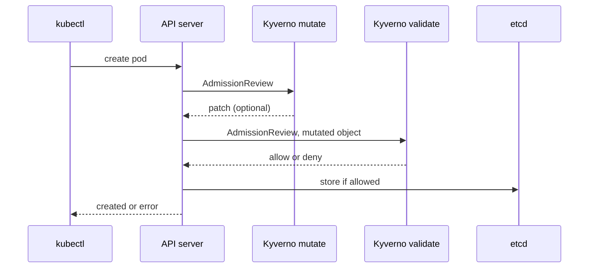

# Validate Rules And Admission

Most platform rules start as a sentence: "every container in `starfleet` must have CPU and memory limits". Kyverno lets you write that sentence as a resource the API server enforces on every request. This part shows where Kyverno sits in the request path, writes the rule, and reads what a refused request looks like, for a pod and for a Deployment.

## Kyverno in the request path

Kyverno registers itself with the API server as a **mutating webhook** and a **validating webhook**: HTTPS services that the API server calls during admission. A mutating webhook may change the object; a validating webhook may only accept or reject it.



The diagram shows the API server calling Kyverno's mutating webhook first and its validating webhook second, so validation sees the object after every change.

Kyverno's rules live in two resource kinds. A **ClusterPolicy** applies in every namespace, and a **Policy** applies only in its own namespace. Both contain a list of `rules`, and each rule has:

- `match` and an optional `exclude`: which objects the rule looks at, by kind, namespace, name, labels or the user who sends the request.
- exactly one action: `validate`, `mutate`, `generate` or `verifyImages`.

## A validate rule

A validate rule with a `pattern` describes what a good object looks like. `"?*"` means "any non-empty value".

<!-- astrona:playground:renew -->

Save this as `clusterpolicy-require-limits.yaml`:

```yaml
apiVersion: kyverno.io/v1
kind: ClusterPolicy
metadata:
  name: require-limits
spec:
  rules:
    - name: require-cpu-memory-limits
      match:
        any:
          - resources:
              kinds: ["Pod"]
              namespaces: ["starfleet"]
      validate:
        failureAction: Enforce
        message: "Every container in starfleet must set resources.limits.cpu and resources.limits.memory."
        pattern:
          spec:
            containers:
              - resources:
                  limits:
                    cpu: "?*"
                    memory: "?*"
```

Apply it and check that Kyverno has loaded it:

```sh
kubectl apply -f clusterpolicy-require-limits.yaml
kubectl get clusterpolicy require-limits
```

You should see:

```text
Warning: kyverno.io/v1 ClusterPolicy is deprecated and will be removed in a future release; migrate to ValidatingPolicy, MutatingPolicy, GeneratingPolicy or ImageValidatingPolicy (policies.kyverno.io), see https://kyverno.io/docs/guides/migration-to-cel/
clusterpolicy.kyverno.io/require-limits created
Warning: kyverno.io/v1 ClusterPolicy is deprecated and will be removed in a future release; migrate to ValidatingPolicy, MutatingPolicy, GeneratingPolicy or ImageValidatingPolicy (policies.kyverno.io), see https://kyverno.io/docs/guides/migration-to-cel/
NAME             ADMISSION   BACKGROUND   READY   AGE   MESSAGE
require-limits   true        true         True    0s    Ready
```

`READY` `True` means the webhooks enforce the policy now. The warning is new in Kyverno 1.19: the `kyverno.io/v1` ClusterPolicy still works and is what most documentation and exam tasks use, but Kyverno is moving to new CEL-based kinds in the `policies.kyverno.io` group, such as `ValidatingPolicy`. The rest of this module uses ClusterPolicy and leaves the warning out of the output.

## Read a rejection

Try to create a pod without limits in `starfleet`.

Save this as `pod-no-limits.yaml`:

```yaml
apiVersion: v1
kind: Pod
metadata:
  name: no-limits
  namespace: starfleet
spec:
  serviceAccountName: shuttle
  containers:
    - name: test
      image: curlimages/curl:8.22.0
      command: ["sh", "-c", "sleep 3600"]
```

Apply it:

```sh
kubectl apply -f pod-no-limits.yaml
```

You should see:

```text
Error from server: error when creating "pod-no-limits.yaml": admission webhook "validate.kyverno.svc-fail" denied the request: 

resource Pod/starfleet/no-limits was blocked due to the following policies 

require-limits:
  require-cpu-memory-limits: 'validation error: Every container in starfleet must set resources.limits.cpu and resources.limits.memory. rule require-cpu-memory-limits failed at path /spec/containers/0/resources/limits/'
```

The message names every part you need. `admission webhook "validate.kyverno.svc-fail"` says Kyverno's validating webhook refused the object. The next block lists the policy (`require-limits`), the rule (`require-cpu-memory-limits`), your `message`, and the path in the object where the pattern failed: `/spec/containers/0/resources/limits/`, the limits of the first container.

## The same rule for Deployments

You wrote the rule for pods, but people create Deployments. Kyverno handles that with **autogen**: for a pod rule, it generates matching rules for the pod templates of Deployments, ReplicaSets, StatefulSets, DaemonSets, Jobs and CronJobs. The policy status lists them:

```sh
kubectl get clusterpolicy require-limits -o jsonpath='{range .status.autogen.rules[*]}{.name}{" -> "}{.match.any[0].resources.kinds}{"\n"}{end}'
```

You should see:

```text
autogen-require-cpu-memory-limits -> ["apps/v1/DaemonSet","apps/v1/Deployment","batch/v1/Job","apps/v1/ReplicaSet","v1/ReplicationController","apps/v1/StatefulSet"]
autogen-cronjob-require-cpu-memory-limits -> ["batch/v1/CronJob"]
```

So a Deployment without limits is refused when you create it, with the rule name `autogen-require-cpu-memory-limits` and a path into the pod template:

```text
require-limits:
  autogen-require-cpu-memory-limits: 'validation error: Every container in starfleet must set resources.limits.cpu and resources.limits.memory. rule autogen-require-cpu-memory-limits failed at path /spec/template/spec/containers/0/resources/limits/'
```

Deployments that already existed are a different story. Restart `probe`, which has no limits:

```sh
kubectl -n starfleet rollout restart deployment probe
kubectl -n starfleet get replicasets -l app=probe
```

You should see something like:

```text
deployment.apps/probe restarted
NAME               DESIRED   CURRENT   READY   AGE
probe-79846c4c6d   1         0         0       5s
probe-bc75b447c    1         1         1       37s
```

The restart, an update of a Deployment that already broke the rule, was accepted, but the new ReplicaSet cannot create its pod: the pod create request is refused, and the ReplicaSet records `FailedCreate` events with Kyverno's message. An Enforce policy on a busy namespace stops rollouts this way, without any error on the command that started them.

You now know where Kyverno runs, how a validate rule with a pattern describes a good object, how to read a rejection down to the policy, rule and path, and how autogen extends a pod rule to every workload kind. The open question is how to introduce a rule like this without stopping running workloads, and how to see who breaks it.

## Common pitfalls

> [!WARNING]
> - **Writing a pod rule and forgetting the Deployments.** Autogen covers them, but it changes the rule name to `autogen-<rule>`; use both names when you search reports or write exceptions.
> - **Expecting a pattern to check only one container.** A list in a pattern applies to every element: all containers must match.
> - **Turning on Enforce in a busy namespace.** Existing workloads keep running, but their next pods are refused. Start in Audit.
> - **Reading `svc-fail` as an error in Kyverno.** It is the name of the webhook that fails closed; the denial is the policy working.
