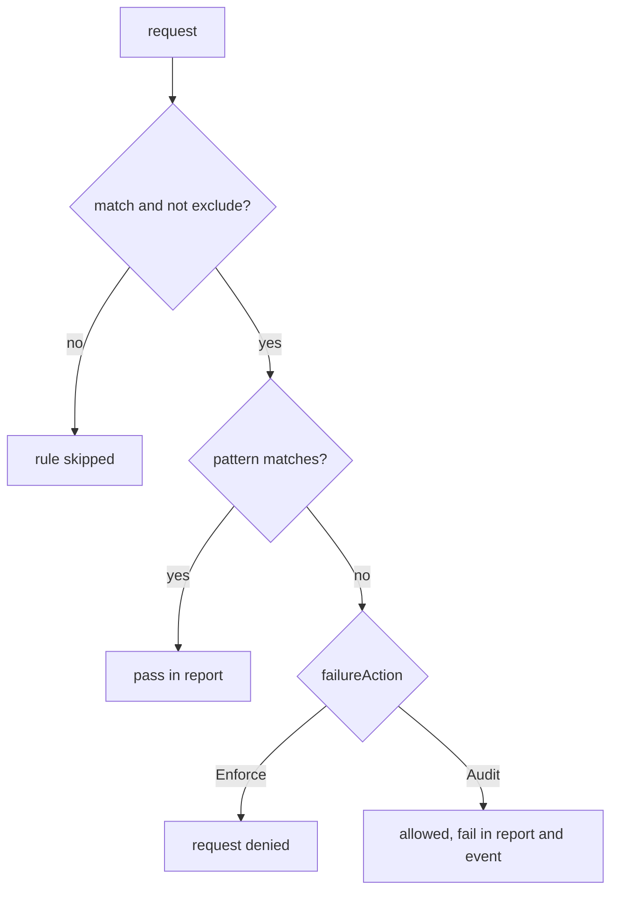

# Enforce, Audit And Policy Reports

A new rule usually meets an old cluster. Some workloads already break it, and you need to know which ones before the rule starts blocking anything. Kyverno has two answers: the Audit action, which records a failure instead of refusing the request, and PolicyReports, which list the result of every rule for every object, including objects that existed before the policy. This part reads both.

## Policy reports from the background scan

Kyverno's **background scan** checks existing objects against every policy with `background: true`, the default, and writes the results into **PolicyReport** resources: one report per object, in the object's namespace. A **ClusterPolicyReport** does the same for cluster-wide objects. The reports exist whether the policy is in Enforce or Audit.

<!-- astrona:playground:renew -->

```sh
kubectl -n starfleet get policyreports
```

You should see something like (the report names are object UIDs and differ on your cluster):

```text
NAME                                   KIND         NAME                       PASS   FAIL   WARN   ERROR   SKIP   AGE
0365877e-380c-4550-8ce6-b3a620c41bd4   ReplicaSet   probe-bc75b447c            0      1      0      0       0      30s
159916fb-35af-4fd9-b90a-bc3ab32ea364   Deployment   shuttle                    0      1      0      0       0      30s
2b98ca8d-ce49-449d-8e76-3970dad301ef   Deployment   scout                      0      1      0      0       0      30s
420b2c1f-7d34-4abe-a19e-1e133aa64a23   Deployment   probe                      0      1      0      0       0      30s
6df027c8-2624-4330-9d0c-03173b6a4225   ReplicaSet   shuttle-5f48559f85         0      1      0      0       0      30s
74df5acf-0635-40da-b2c2-ab8c3c937e81   Pod          probe-bc75b447c-gc2n2      0      1      0      0       0      30s
9984575d-f3a9-4b9a-b58a-4ef294bf6ec1   Pod          shuttle-5f48559f85-5ssdk   0      1      0      0       0      30s
bb8c660f-a1e3-484e-8e08-b8cdfe30a51b   Pod          scout-64445474d5-lmrz2     0      1      0      0       0      30s
f634c79e-3e31-4b30-8db8-cab7312fdb53   ReplicaSet   scout-64445474d5           0      1      0      0       0      30s
```

All three workloads fail, at every level: Deployment, ReplicaSet and Pod. `probe` has no limits, as expected. `scout` and `shuttle` set a memory limit but no CPU limit, which also breaks the rule. A rule meets the cluster as it really is, not as you remember it, and the report is how you find out before anything is blocked.

To read why one object failed, open its report. This command picks the report for the `scout` Deployment and prints its results:

```sh
kubectl -n starfleet get policyreport $(kubectl -n starfleet get policyreports -o jsonpath='{range .items[?(@.scope.name=="scout")]}{.metadata.name}{end}') -o yaml | sed -n '/^results:/,$p'
```

You should see something like (the timestamp and UID are left out):

```text
results:
- message: 'validation error: Every container in starfleet must set resources.limits.cpu
    and resources.limits.memory. rule autogen-require-cpu-memory-limits failed at
    path /spec/template/spec/containers/0/resources/limits/cpu/'
  policy: require-limits
  properties:
    process: background scan
  result: fail
  rule: autogen-require-cpu-memory-limits
  scored: true
  source: kyverno
scope:
  apiVersion: apps/v1
  kind: Deployment
  name: scout
  namespace: starfleet
summary:
  error: 0
  fail: 1
  pass: 0
  skip: 0
  warn: 0
```

The path ends in `limits/cpu/`: the CPU limit is the missing part. `process: background scan` says the result came from the scan, not from an admission request.

## Switch the rule to Audit

`failureAction` decides what a failed validation does. `Enforce` refuses the request. `Audit` lets it through and records the failure in a PolicyReport and as a `PolicyViolation` event. In `clusterpolicy-require-limits.yaml`, change `failureAction: Enforce` to `failureAction: Audit`, and apply it:

```sh
kubectl apply -f clusterpolicy-require-limits.yaml
```

Now create a Deployment without limits.

Save this as `deployment-beacon.yaml`:

```yaml
apiVersion: apps/v1
kind: Deployment
metadata:
  name: beacon
  namespace: starfleet
spec:
  replicas: 1
  selector:
    matchLabels:
      app: beacon
  template:
    metadata:
      labels:
        app: beacon
    spec:
      serviceAccountName: shuttle
      containers:
        - name: beacon
          image: curlimages/curl:8.22.0
          command: ["sh", "-c", "sleep 3600"]
```

Apply it:

```sh
kubectl apply -f deployment-beacon.yaml
kubectl -n starfleet rollout status deployment beacon
```

You should see:

```text
deployment.apps/beacon created
Waiting for deployment "beacon" rollout to finish: 0 of 1 updated replicas are available...
deployment "beacon" successfully rolled out
```

The Deployment and its pod were created. The `probe` rollout that was stuck in the last part finishes as well, because its new pod is no longer refused. The failures are recorded instead. After a short wait, list the Deployment reports with the columns that matter:

```sh
kubectl -n starfleet get policyreports -o custom-columns='KIND:.scope.kind,NAME:.scope.name,PASS:.summary.pass,FAIL:.summary.fail' | grep -E 'KIND|Deployment'
```

You should see something like:

```text
KIND         NAME                       PASS   FAIL
Deployment   shuttle                    0      1
Deployment   scout                      0      1
Deployment   probe                      0      1
Deployment   beacon                     0      1
```

Kyverno also writes an event for each failure in Audit mode, on the object that failed:

```sh
kubectl -n starfleet get events --field-selector reason=PolicyViolation -o custom-columns=OBJECT:.involvedObject.name,MESSAGE:.message --no-headers | head -3
```

You should see something like (shortened):

```text
beacon-9b494858-hk466   policy require-limits/require-cpu-memory-limits fail: validation error: Every container in starfleet must set ...
beacon-9b494858-hk466   policy require-limits/require-cpu-memory-limits fail: validation error: Every container in starfleet must set ...
beacon-9b494858         policy require-limits/autogen-require-cpu-memory-limits fail: validation error: Every container in starfleet must set ...
```

The usual way to introduce a rule is now clear: apply it in Audit, read the reports until every workload passes or has a plan, then switch to Enforce.



The diagram shows one rule's path: selection by `match` and `exclude`, the pattern check, and the different outcome of a failure under Enforce and Audit.

You can now see every existing object that breaks a rule before the rule blocks anything, read the reason in a PolicyReport, and choose between Enforce and Audit for a rule. The open question is what Kyverno can do besides saying yes or no: change objects as they come in, and create new ones.

## Common pitfalls

> [!WARNING]
> - **Switching straight to Enforce without reading the reports.** Every failing workload stops at its next rollout.
> - **Expecting Audit to warn on the command line.** It does not; the failure is only in the report and the event.
> - **Reading reports right after a change.** The background scan and the reports controller need a few seconds to a minute to update.
> - **Searching reports by rule name only.** Pod rules appear as `autogen-<rule>` on Deployments and ReplicaSets.
