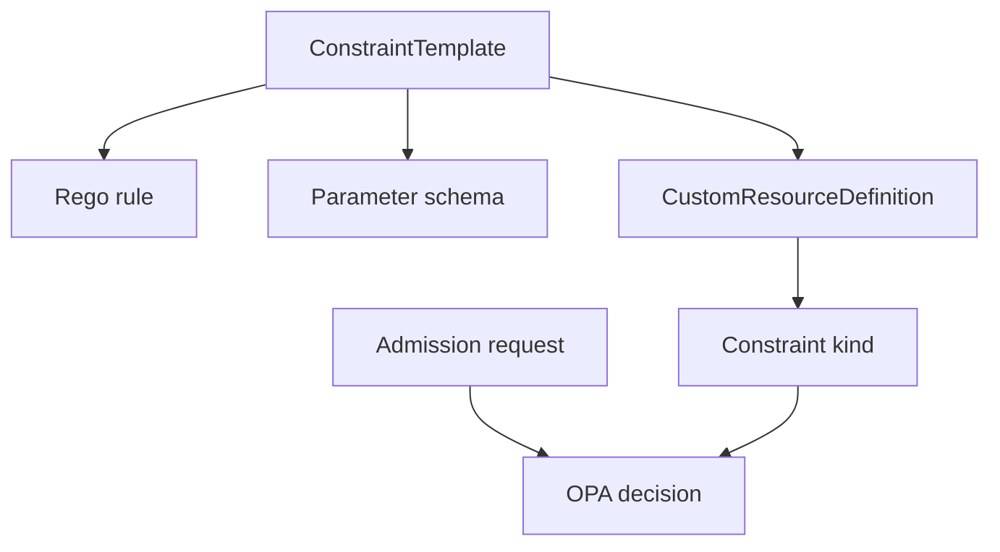

# ConstraintTemplates And Rego

Gatekeeper uses two layers. A **ConstraintTemplate** is a Kubernetes resource that defines a new constraint kind and the Rego code behind it. A **Constraint** is an instance of that kind with match rules and parameters. This part builds the template first, because no constraint can exist until its kind exists.

## From a template to a new kind

When Gatekeeper accepts a ConstraintTemplate, it creates a CustomResourceDefinition for the kind named in the template. A CustomResourceDefinition is a Kubernetes object that adds a new resource type to the API server.



The diagram shows that the template creates the API kind, while the Rego rule and each constraint decide admission requests.

A template must name a kind under `spec.crd.spec.names.kind`. If the constraint needs parameters, the template also declares a schema for them under `openAPIV3Schema`. The schema below says each constraint may pass a list of label names.

## A required-label template

The Rego code reads the object under `input.review.object` and the constraint parameters under `input.parameters`. The rule returns a `violation` when a required label is missing.

<!-- astrona:playground:renew -->

Save this as `constrainttemplate-required-labels.yaml`:

```yaml
apiVersion: templates.gatekeeper.sh/v1
kind: ConstraintTemplate
metadata:
  name: k8srequiredlabels
spec:
  crd:
    spec:
      names:
        kind: K8sRequiredLabels
      validation:
        openAPIV3Schema:
          type: object
          properties:
            labels:
              type: array
              items:
                type: string
  targets:
    - target: admission.k8s.gatekeeper.sh
      rego: |
        package k8srequiredlabels

        violation[{"msg": msg}] {
          required := input.parameters.labels[_]
          not input.review.object.metadata.labels[required]
          msg := sprintf("missing required label: %v", [required])
        }
```

The package name usually matches the template name. The `required := input.parameters.labels[_]` line loops over each label name passed by the constraint. The `not` line is true when the object has no label with that name. The `msg` line creates the message that Gatekeeper prints in the admission error.

Apply it:

```sh
kubectl apply -f constrainttemplate-required-labels.yaml
kubectl get constrainttemplate k8srequiredlabels
kubectl get crd k8srequiredlabels.constraints.gatekeeper.sh
```

You should see:

```text
constrainttemplate.templates.gatekeeper.sh/k8srequiredlabels created
NAME                AGE
k8srequiredlabels   0s
NAME                                          CREATED AT
k8srequiredlabels.constraints.gatekeeper.sh   2026-10-10T16:39:09Z
```

The exact timestamp changes in your cluster. The important result is the new CustomResourceDefinition named `k8srequiredlabels.constraints.gatekeeper.sh`. That means the API server now accepts resources with kind `K8sRequiredLabels` in the `constraints.gatekeeper.sh` API group.

You now have a constraint kind, a parameter schema and a Rego rule that can report missing labels. The rule still does nothing by itself. The next step is to create a constraint that tells Gatekeeper which objects to check and what label to require.

## Common pitfalls

> [!WARNING]
> - **Creating a Constraint before the template is ready.** The API server does not know the constraint kind until Gatekeeper creates the CustomResourceDefinition.
> - **Forgetting the parameter schema.** Gatekeeper v1 ConstraintTemplates need a structural schema for parameters.
> - **Putting the object path in the wrong place.** Admission objects are under `input.review.object`, not directly under `input.object`.
> - **Treating Rego as YAML.** Rego has its own syntax. A missing brace or unsafe variable appears in the ConstraintTemplate status.
