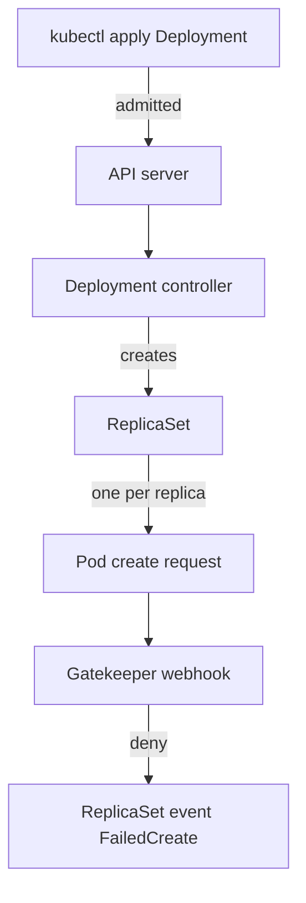

# Constraints And Pods Created By Controllers

Most pods in a cluster are not created by a person. A Deployment creates a ReplicaSet, and the ReplicaSet creates the pods. A Constraint that matches Pods checks those pods too, because every pod create request passes through admission, whatever sent it. The surprise is where the refusal shows up: `kubectl apply` of the Deployment succeeds, the pods never appear, and the error sits in the events of the ReplicaSet. This part makes that happen on purpose and shows where to read it.

## Who sends the pod create request

A Deployment is a Kubernetes object that describes a pod template and a replica count. The Deployment controller, a loop inside `kube-controller-manager`, creates a ReplicaSet for each version of the pod template. The ReplicaSet controller then sends one pod create request per missing replica to the API server. The Gatekeeper webhook runs on that request, not on the Deployment request, when the constraint matches only Pods.



The diagram shows that the Deployment is stored before any pod exists, so the person who ran `kubectl apply` gets a success message, and the refusal lands on the ReplicaSet later.

## Make a Deployment fail its pods

The constraint `require-team-label` from this module requires the `team` label on pods in `starfleet`, and its enforcement action is `warn` after the last change. Set it back to `deny`. Change only `enforcementAction` in `constraint-require-team-label.yaml` to `deny`, then apply it:

<!-- astrona:playground:renew -->

```sh
kubectl apply -f constraint-require-team-label.yaml
kubectl get k8srequiredlabels require-team-label
```

The `ENFORCEMENT-ACTION` column shows `deny`. Wait about ten seconds for Gatekeeper to load the change.

The `probe` Deployment in `starfleet` has no `team` label in its pod template, and its one pod was created before the constraint existed. Force the Deployment to replace that pod:

```sh
kubectl -n starfleet rollout restart deployment/probe
kubectl -n starfleet rollout status deployment/probe --timeout=30s
```

The first command prints `deployment.apps/probe restarted`: the API server admitted the Deployment update, because the constraint does not match Deployments. The second command does not finish. It waits until the timeout and reports that the rollout is not complete, with `0` of `1` updated replicas available. Look at what the Deployment controller created:

```sh
kubectl -n starfleet get deployment probe
kubectl -n starfleet get replicaset -l app=probe
```

The Deployment line shows `1/1` in `READY` but `0` in `UP-TO-DATE`: the old pod still runs, because a rolling update removes it only after a new pod is ready. The ReplicaSet list has two entries. The old one has `1` in `DESIRED` and `1` in `CURRENT`. The new one has `1` in `DESIRED`, `0` in `CURRENT` and `0` in `READY`: it wants a pod and could not create one.

## Read the refusal where it is

The new ReplicaSet holds the error. Describe it and read the events at the end:

```sh
kubectl -n starfleet describe replicaset -l app=probe | grep -B2 -A6 "^Events:"
```

The new ReplicaSet shows a `Warning` event with the reason `FailedCreate`. Its message starts with `Error creating:` and then carries the same text the admission webhook returns to `kubectl`: the webhook name `validation.gatekeeper.sh`, the constraint name `[require-team-label]` and the Rego message `missing required label: team`. The ReplicaSet controller retries with a growing delay, so the event count rises while the fault stays.

The Deployment also records the problem in its status. Read its conditions:

```sh
kubectl -n starfleet get deployment probe -o jsonpath='{range .status.conditions[*]}{.type}{"="}{.status}{" reason="}{.reason}{"\n"}{end}'
```

Look for a condition of type `ReplicaFailure` with the status `True` and the reason `FailedCreate`. The `Progressing` condition stays `True` for a while and turns to `False` with the reason `ProgressDeadlineExceeded` after ten minutes. Neither condition repeats the Gatekeeper message; the ReplicaSet event is the only place that names the constraint.

Fix the pod template, not the constraint. Add the label where the ReplicaSet copies it into each pod, under `spec.template.metadata.labels`:

```sh
kubectl -n starfleet patch deployment probe --type merge -p '{"spec":{"template":{"metadata":{"labels":{"team":"starfleet"}}}}}'
kubectl -n starfleet rollout status deployment/probe --timeout=120s
kubectl -n starfleet get pods -l app=probe --show-labels
```

The patch creates a third ReplicaSet with the label in its template. The rollout finishes, and the pod list shows one new `probe` pod with `team=starfleet` among its labels. A label on the Deployment's own `metadata.labels` would not have helped: the ReplicaSet copies only the pod template into the pods.

You now know that a Constraint on Pods also governs the pods a Deployment creates, that the person applying the Deployment sees no error, and that the refusal is in the `FailedCreate` event of the newest ReplicaSet and in the `ReplicaFailure` condition of the Deployment. The open question is the same one the exam asks: when a packaged workload, for example a Helm chart, breaks a rule, where in the package does the fix belong?

## Common pitfalls

> [!WARNING]
> - **Expecting `kubectl apply` of the Deployment to fail.** A constraint that matches only Pods admits the Deployment; the pods fail later, inside the ReplicaSet.
> - **Reading `kubectl get deployment` as healthy.** `READY 1/1` can be the old pod. Check `UP-TO-DATE` and the newest ReplicaSet's `CURRENT` count.
> - **Describing the Deployment for the message.** The Deployment shows `ReplicaFailure`; the Gatekeeper text is in the ReplicaSet events.
> - **Labelling the Deployment instead of the pod template.** Only `spec.template.metadata.labels` reaches the pods.
> - **Changing the selector to add the label.** `spec.selector` of a Deployment is immutable; add the label to the template only.

## Your mission: Satisfy A Gatekeeper Constraint With A Helm Chart Lab

You can now write a Constraint with rules on Pods and Deployments and find the refusal a controller-created pod leaves behind. The mission starts a cluster with Gatekeeper, Helm on the terminal and a `probe` chart that runs one replica and labels the Deployment only; you write a template with two violation rules and a `deny` constraint for `starfleet`, then repair the chart, raise its version to `0.2.0` and upgrade the release until its pods run.

Pause the playground first, so the lab has the memory it needs:

```sh
astrona stop ats-021-playground-030-02
```

Start the lab, then grade it when you are done:

```sh
astrona run --git ssh://git@github.com/astrona-io/ATS021.git -c sections/section-030/module-02/labs/lab-02
astrona submit --git ssh://git@github.com/astrona-io/ATS021.git -c sections/section-030/module-02/labs/lab-02
```

When you are done, remove the lab and start the playground again:

```sh
astrona destroy ats-021-lab-030-02-02
astrona start ats-021-playground-030-02
```
