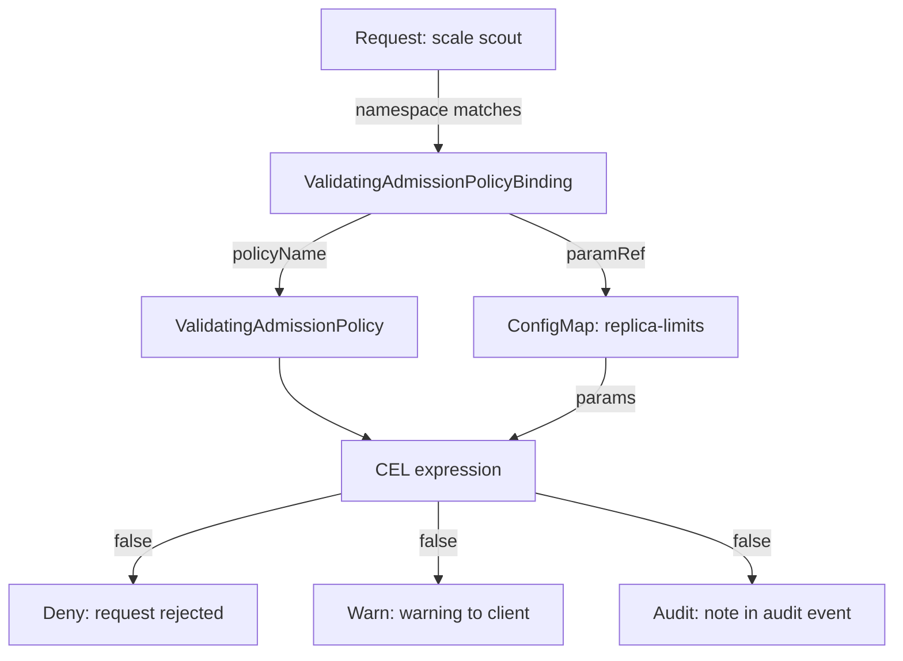

# Bindings, Params And Validation Actions

A limit written into a CEL expression is the same for every namespace that the binding selects. Platform teams usually want the rule in one place and the number in another, so a team can get a different limit without a new policy. This part moves the limit into a ConfigMap, then changes what the binding does when the check fails.

## Three objects, three jobs

A ValidatingAdmissionPolicy can declare a **params** kind with `paramKind`. A params object is any Kubernetes object, often a ConfigMap, whose fields the expressions read as `params`. The binding picks which params object to use with `paramRef`, and decides with `validationActions` what a failed check does.



The diagram shows that the binding selects the request, the policy holds the expression, the ConfigMap feeds the expression, and the binding's actions decide what a `false` result causes.

## Read the limit from a ConfigMap

The playground already has the params object. Look at it first.

<!-- astrona:playground:renew -->

```sh
kubectl -n starfleet get configmap replica-limits -o jsonpath='{.data}{"\n"}'
```

You should see:

```text
{"maxReplicas":"5"}
```

ConfigMap values are always strings, so the expression converts the value with `int()` before it compares numbers.

Save this as `validatingadmissionpolicy-max-replicas.yaml`:

```yaml
apiVersion: admissionregistration.k8s.io/v1
kind: ValidatingAdmissionPolicy
metadata:
  name: max-replicas
spec:
  failurePolicy: Fail
  paramKind:
    apiVersion: v1
    kind: ConfigMap
  matchConstraints:
    resourceRules:
      - apiGroups: ["apps"]
        apiVersions: ["v1"]
        operations: ["CREATE", "UPDATE"]
        resources: ["deployments", "deployments/scale"]
  validations:
    - expression: >-
        object.spec.replicas <= int(params.data.maxReplicas) ||
        (request.operation == 'UPDATE' && object.spec.replicas <= oldObject.spec.replicas)
      messageExpression: >-
        object.kind + ' ' + object.metadata.name + ' asks for ' +
        string(object.spec.replicas) + ' replicas; the limit is ' + params.data.maxReplicas
```

`paramKind` says the params object is a `v1` ConfigMap. The expression and the message both read `params.data.maxReplicas` instead of a fixed `5`.

Save this as `validatingadmissionpolicybinding-max-replicas.yaml`:

```yaml
apiVersion: admissionregistration.k8s.io/v1
kind: ValidatingAdmissionPolicyBinding
metadata:
  name: max-replicas-production
spec:
  policyName: max-replicas
  validationActions: ["Deny"]
  paramRef:
    name: replica-limits
    parameterNotFoundAction: Deny
  matchResources:
    namespaceSelector:
      matchLabels:
        environment: production
```

`paramRef.name` names the ConfigMap. With no `paramRef.namespace`, the API server looks for it in the namespace of the request, so every production namespace can carry its own `replica-limits`. `parameterNotFoundAction: Deny` rejects requests in a matched namespace that has no such ConfigMap; `Allow` would let them through. The field is required whenever `paramRef` is set.

Apply both:

```sh
kubectl apply -f validatingadmissionpolicy-max-replicas.yaml
kubectl apply -f validatingadmissionpolicybinding-max-replicas.yaml
kubectl get validatingadmissionpolicies,validatingadmissionpolicybindings
```

You should see:

```text
validatingadmissionpolicy.admissionregistration.k8s.io/max-replicas configured
validatingadmissionpolicybinding.admissionregistration.k8s.io/max-replicas-production configured
NAME                                                                  VALIDATIONS   PARAMKIND      AGE
validatingadmissionpolicy.admissionregistration.k8s.io/max-replicas   1             v1/ConfigMap   4s

NAME                                                                                    POLICYNAME     PARAMREF           AGE
validatingadmissionpolicybinding.admissionregistration.k8s.io/max-replicas-production   max-replicas   */replica-limits   4s
```

The `PARAMKIND` column shows `v1/ConfigMap`, and `PARAMREF` shows `*/replica-limits`: any namespace, name `replica-limits`. Now test the rule from the 3 replicas `scout` has:

```sh
kubectl -n starfleet scale deployment scout --replicas=9
kubectl -n starfleet scale deployment scout --replicas=5
kubectl -n starfleet scale deployment scout --replicas=6
```

You should see:

```text
The deployments "scout" is invalid: : ValidatingAdmissionPolicy 'max-replicas' with binding 'max-replicas-production' denied request: Scale scout asks for 9 replicas; the limit is 5
deployment.apps/scout scaled
The deployments "scout" is invalid: : ValidatingAdmissionPolicy 'max-replicas' with binding 'max-replicas-production' denied request: Scale scout asks for 6 replicas; the limit is 5
```

The limit `5` in the message now comes from the ConfigMap. Change the ConfigMap and the same request gives a different answer:

```sh
kubectl -n starfleet patch configmap replica-limits --type=merge -p '{"data":{"maxReplicas":"8"}}'
kubectl -n starfleet scale deployment scout --replicas=6 --dry-run=server
```

You should see:

```text
configmap/replica-limits patched
deployment.apps/scout scaled (server dry run)
```

Set it back to `5` with the same `patch` command before you continue.

The `outpost` namespace has no `replica-limits` ConfigMap. If it were labelled `production`, `parameterNotFoundAction` would decide. Try it for a moment, then put the label back:

```sh
kubectl label namespace outpost environment=production --overwrite
kubectl -n outpost create deployment scout --image=ghcr.io/stefanprodan/podinfo:6.15.0 --replicas=1 --dry-run=server
kubectl label namespace outpost environment=sandbox --overwrite
```

You should see:

```text
namespace/outpost labeled
error: failed to create deployment: deployments.apps "scout" is forbidden: ValidatingAdmissionPolicy 'max-replicas' with binding 'max-replicas-production' denied request: failed to configure binding: no params found for policy binding with `Deny` parameterNotFoundAction
namespace/outpost labeled
```

Even a 1-replica Deployment is rejected, because the binding could not find its params. The message says so directly.

## Deny, Warn and Audit

`validationActions` is a list of what happens when an expression is `false`:

- `Deny`: the API server rejects the request with the message.
- `Warn`: the API server lets the request through and returns the message as a warning, which kubectl prints as `Warning:`.
- `Audit`: the API server lets the request through and adds the failure to the request's audit event, as the annotation `validation.policy.admission.k8s.io/validation_failure`. This only shows up when API server audit logging is turned on, which it is not in this playground.

A rollout often starts with `["Warn", "Audit"]`, so teams see the warnings and the audit log records them before anything is blocked.

Save this as `validatingadmissionpolicybinding-max-replicas.yaml` (it replaces the `Deny` version):

```yaml
apiVersion: admissionregistration.k8s.io/v1
kind: ValidatingAdmissionPolicyBinding
metadata:
  name: max-replicas-production
spec:
  policyName: max-replicas
  validationActions: ["Warn", "Audit"]
  paramRef:
    name: replica-limits
    parameterNotFoundAction: Deny
  matchResources:
    namespaceSelector:
      matchLabels:
        environment: production
```

Apply it:

```sh
kubectl apply -f validatingadmissionpolicybinding-max-replicas.yaml
```

Then scale over the limit:

```sh
kubectl -n starfleet scale deployment scout --replicas=7
kubectl -n starfleet get deployment scout
```

You should see:

```text
Warning: Validation failed for ValidatingAdmissionPolicy 'max-replicas' with binding 'max-replicas-production': Scale scout asks for 7 replicas; the limit is 5
deployment.apps/scout scaled
NAME    READY   UP-TO-DATE   AVAILABLE   AGE
scout   5/7     7            5           13m
```

The same expression failed, but this time the request went through and kubectl printed the message as a warning. The API server refuses one combination: a binding with both `Deny` and `Warn` is invalid, because a denied request already returns the message. If you change the list to `["Deny", "Warn"]` and apply it, you see:

```text
The ValidatingAdmissionPolicyBinding "max-replicas-production" is invalid: spec.validationActions: Invalid value: ["Deny","Warn"]: must not contain both Deny and Warn (repeating the same validation failure information in the API response and headers serves no purpose)
```

`["Deny", "Audit"]` is valid: the request is rejected and the failure is also recorded in the audit event. Change the list back to `["Deny"]` and apply it again before you move on.

You can now keep a rule in one policy, feed it a value per namespace through a ConfigMap, decide what happens when params are missing, and choose between blocking, warning and recording. The open question is when this built-in tool is the right choice at all, and how to find a mistake in a CEL expression.

## Common pitfalls

> [!WARNING]
> - **Comparing a ConfigMap string with a number.** `params.data.maxReplicas` is a string; convert it with `int()` in the expression.
> - **Forgetting `parameterNotFoundAction`.** It is required with `paramRef`. With `Deny`, a namespace that matches the binding but has no params object rejects every matched request.
> - **Expecting `Audit` to print something.** `Audit` only adds an annotation to the audit event; without audit logging nothing is visible.
> - **Combining `Deny` and `Warn`.** The API server rejects that binding; use `["Deny", "Audit"]` or `["Warn", "Audit"]`.
> - **Trusting a stale answer after a params change.** Test with a server-side dry run after you edit the ConfigMap. In one test run on Kubernetes 1.35.8 the API server kept the old limit after a ConfigMap edit until the API server restarted; after that restart, every later edit took effect at once.
