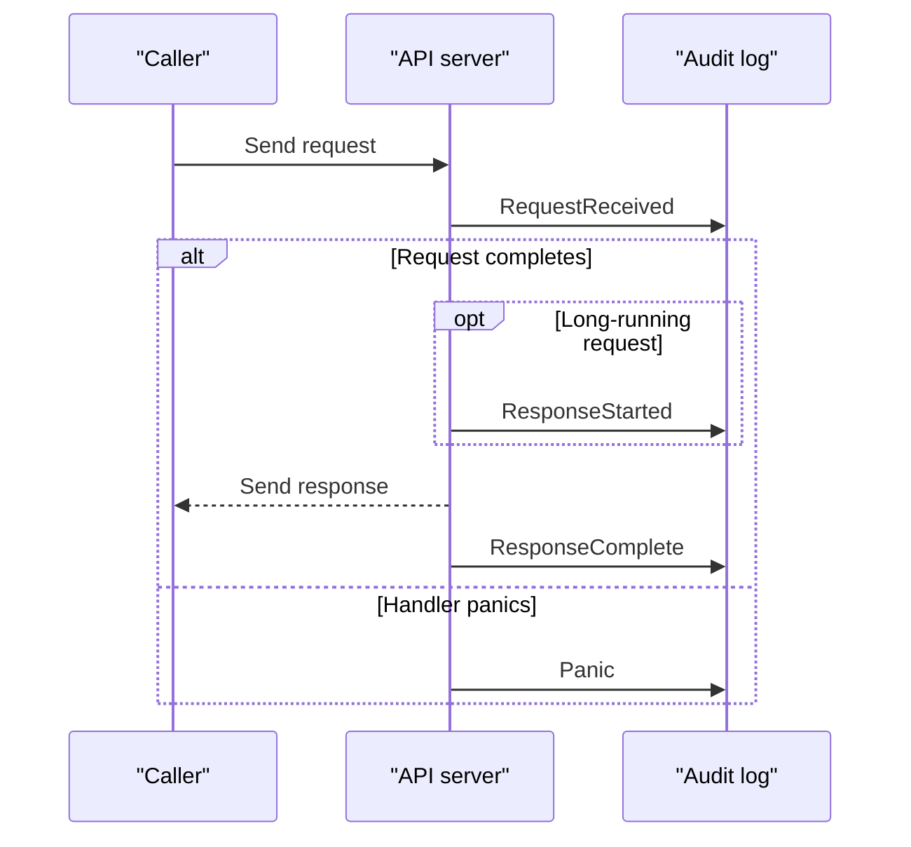
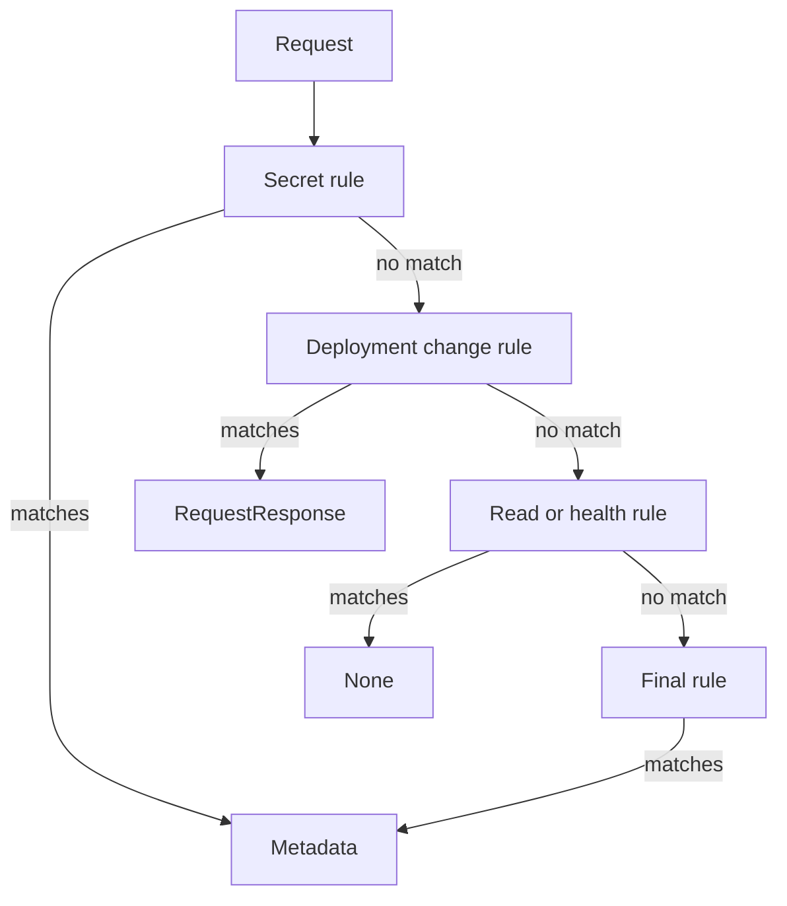

# Audit Policy Rules, Levels And Stages

The `deck-cleaner` workload reads a Secret and deletes a Deployment with the same identity. Those two requests need different evidence: the Secret's name and caller are useful, but its password should stay out of the log. The Deployment change needs more detail so you can inspect what the caller sent.

An **audit policy** is a file that tells the Kubernetes application programming interface (API) server how much of each request to record. Audit logging records activity; it does not grant access or reject a request. Authentication and authorization still decide who may act.

## Start with the requests to record

The playground has a CronJob, a resource that creates Jobs on a schedule. Its Job runs as the `deck-cleaner` service account, the identity its pod uses for API requests. Check the schedule and identity first.

<!-- astrona:playground:renew -->

```sh
kubectl -n outpost get cronjob deck-cleaner -o jsonpath='{.spec.schedule}{"\n"}{.spec.jobTemplate.spec.template.spec.serviceAccountName}{"\n"}'
```

You should see something like:

```text
*/2 * * * *
deck-cleaner
```

The schedule runs every two minutes. The caller will appear in events as `system:serviceaccount:outpost:deck-cleaner`, because the service account belongs to `outpost`, even though it changes objects in `starfleet`.

Set a readable variable for the playground's control plane node container, then inspect the existing manifest:

```sh
export CONTROL_PLANE=astro-ats-021-playground-040-01-control-plane
podman exec "$CONTROL_PLANE" sh -c 'grep -- --audit /etc/kubernetes/manifests/kube-apiserver.yaml || echo "No audit flags configured"'
```

You should see:

```text
No audit flags configured
```

There is no audit history to search yet. The API server cannot record requests that finished before audit logging was enabled.

## Choose the detail and the stage

An **audit event** is a record of one request at one point in its processing. The event's **level** says how much detail the policy allowed. Its **stage** says when the API server produced it.

| Level | What the event contains |
| --- | --- |
| `None` | No event |
| `Metadata` | Caller, verb, target, timestamps and response status; no request or response body |
| `Request` | Metadata and the request body, when the request has one |
| `RequestResponse` | Metadata and the request and response bodies, when present |

More detail is not always better. A Secret response body contains its data, and a Deployment body may contain sensitive environment values. Keep Secret requests at `Metadata`, and give access to logs only to identities that need them.

Stages describe the request's progress:

- `RequestReceived`: the API server received the request, before it handles it.
- `ResponseStarted`: the response headers were sent for a long-running request, such as a watch.
- `ResponseComplete`: the response body has finished sending.
- `Panic`: request handling panicked.



The diagram names the possible audit stages; a panic is an alternative failure path, and a short request has no `ResponseStarted` event.

The policy below omits `RequestReceived`. For a normal request, the remaining `ResponseComplete` event includes the outcome. Several stage events for one request share an `auditID`, an identifier that lets you group them without counting them as separate actions.

## Write rules in order

The API server uses the **first matching rule**. It does not combine rules or choose the most detailed level. Fields within one rule narrow the match together; values within a list are alternatives. A missing selector means that field does not limit the match.

Save this as `audit-policy.yaml`:

```yaml
apiVersion: audit.k8s.io/v1
kind: Policy
omitStages:
  - RequestReceived
rules:
  - level: Metadata
    resources:
      - group: ""
        resources: ["secrets"]
  - level: RequestResponse
    verbs: ["create", "update", "patch", "delete"]
    resources:
      - group: apps
        resources: ["deployments", "deployments/scale"]
  - level: None
    verbs: ["get", "list", "watch"]
  - level: None
    nonResourceURLs: ["/healthz*", "/livez*", "/readyz*"]
  - level: Metadata
```

The first rule records every Secret request at `Metadata`, including reads. `group: ""` selects the core API group. The next rule records changes to Deployments in the `apps` group at `RequestResponse`. `deployments/scale` covers the subresource, a separate API path that changes the replica count.

The third rule drops other `get`, `list` and `watch` requests. It comes after the Secret rule, so it cannot hide Secret reads. The fourth explicitly drops health paths, including requests with other verbs; health GETs already match the third rule. The final rule records all other requests at `Metadata`.



The diagram shows that evaluation stops at the first match; without the final catch-all rule, an unmatched request would have level `None`.

An audit policy is not an API resource. Do not send it to `kubectl apply`. The API server reads this file from its own filesystem at startup. Prepare that location, save a backup outside the static pod directory, and copy the existing pod manifest to your working folder:

```sh
podman exec "$CONTROL_PLANE" mkdir -p /etc/kubernetes/audit /var/log/kubernetes/audit
podman exec "$CONTROL_PLANE" cp /etc/kubernetes/manifests/kube-apiserver.yaml /etc/kubernetes/kube-apiserver.before-audit.yaml
podman cp "$CONTROL_PLANE":/etc/kubernetes/manifests/kube-apiserver.yaml kube-apiserver.yaml
```

This copy installs the policy without sending it through the Kubernetes API.

Apply it:

```sh
podman cp audit-policy.yaml "$CONTROL_PLANE":/etc/kubernetes/audit/audit-policy.yaml
```

Then check the result:

```sh
podman exec "$CONTROL_PLANE" cat /etc/kubernetes/audit/audit-policy.yaml
```

The check prints the policy you saved. Copying it does not turn logging on; the API server still needs startup flags and mounts that expose both the policy and log directories.

You now have ordered rules that keep Secret bodies out of the log, record Deployment changes in detail, and drop other reads. The remaining work is to make the API server read that file and write events where you can retrieve them.

## Common pitfalls

> [!WARNING]
> - **Putting the read filter first.** A `None` rule for reads would match Secret reads before the `Metadata` rule.
> - **Using `RequestResponse` for Secrets.** A read response can place the Secret's data in the audit log.
> - **Applying the policy as an API object.** The API server reads an audit policy file at startup; it is not stored through `kubectl apply`.
> - **Expecting audit rules to enforce access.** They choose recorded evidence, not the authorization decision.
> - **Looking for earlier activity.** Enabling logging does not recover requests that already finished.
