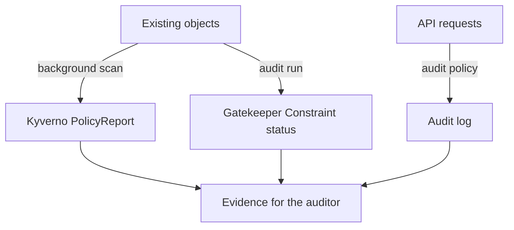

# Answer An Auditor With The Right Evidence

Kyverno reports and the Gatekeeper Constraint show what breaks a rule now. They do not show who changed an object, when, or who tried to read a Secret and failed. The API server audit log holds that evidence. This part reads the audit log for two questions and then matches each kind of question to the source that can answer it.

The playground turned on audit logging with a short policy: every request is recorded at the `Metadata` level, health checks and `kube-proxy` are dropped, and the `RequestReceived` stage is skipped. An **audit event** is one JSON line in the log with the user, the verb, the target, the time and the response code. At `Metadata` level it holds no request body and no response body, which is enough to say who did what, and safe for Secrets.

<!-- astrona:playground:renew -->

Create some activity first. The first command creates a Secret that holds a placeholder password. The second command scales `probe`. The third reads the Secret as yourself, and the fourth reads it as the `drifter` service account of `outpost`, which has no permission to do so. The `--as` flag makes the API server treat the request as coming from that identity.

```sh
kubectl -n starfleet create secret generic scout-db-credentials --from-literal=password=change-me
kubectl -n starfleet scale deploy/probe --replicas=2
kubectl -n starfleet get secret scout-db-credentials -o name
kubectl -n starfleet get secret scout-db-credentials --as=system:serviceaccount:outpost:drifter
```

You should see something like:

```text
secret/scout-db-credentials created
deployment.apps/probe scaled
secret/scout-db-credentials
Error from server (Forbidden): secrets "scout-db-credentials" is forbidden: User "system:serviceaccount:outpost:drifter" cannot get resource "secrets" in API group "" in the namespace "starfleet"
```

The API server wrote one audit event for each request. The log is a file on the control plane node. Set the node name and a helper that prints the log:

```sh
export CONTROL_PLANE=astro-ats-021-playground-040-02-control-plane
read_audit_log() {
  podman exec "$CONTROL_PLANE" cat /var/log/kubernetes/audit/audit.log
}
```

## Who changed a Deployment

The first auditor question is who changed a Deployment in `starfleet`. The cluster itself changes Deployments all the time, for example the deployment controller updates their status, so the filter drops identities that start with `system:`. The filter keeps the verbs that change an object:

```sh
read_audit_log | jq -r 'select(.objectRef.resource=="deployments" and .objectRef.namespace=="starfleet" and (.verb=="create" or .verb=="delete" or .verb=="patch" or .verb=="update") and (.user.username|startswith("system:")|not)) | [.requestReceivedTimestamp,.verb,.user.username,.objectRef.name,.objectRef.subresource,.responseStatus.code] | @tsv'
```

You should see something like:

```text
2026-11-02T19:09:31.439880Z	patch	kubernetes-admin	probe		200
2026-11-02T19:09:31.518608Z	create	kubernetes-admin	relay		201
2026-11-02T19:09:54.016284Z	patch	kubernetes-admin	probe	scale	200
```

The columns are the time, the verb, the user, the object, the subresource and the response code. The last row is the scale. `kubectl scale` sends a `patch` to the `scale` subresource of the Deployment. The first two rows exist only if you labelled `probe` and created `relay` with `kubectl` in this cluster. They show the kind of answer the audit log gives and a Gatekeeper result cannot: who created `relay`. The user is `kubernetes-admin`, the administrator credential of this kind cluster.

## Who read a Secret

The second question is who read the Secret `scout-db-credentials`, and who was refused. This filter selects all events for that one Secret and adds the impersonated user and the authorization decision:

```sh
read_audit_log | jq -r 'select(.objectRef.resource=="secrets" and .objectRef.namespace=="starfleet" and .objectRef.name=="scout-db-credentials") | [.requestReceivedTimestamp,.verb,.user.username,(.impersonatedUser.username // "-"),.responseStatus.code,.annotations["authorization.k8s.io/decision"]] | @tsv'
```

You should see something like:

```text
2026-11-02T19:09:53.949972Z	create	kubernetes-admin	-	201	allow
2026-11-02T19:09:54.070232Z	get	kubernetes-admin	-	200	allow
2026-11-02T19:09:54.123471Z	get	kubernetes-admin	system:serviceaccount:outpost:drifter	403	forbid
```

The last row is a refused read. The `403` response code and the `forbid` decision show that the API server did not return the Secret. The `impersonatedUser` field holds the service account that the request acted as. When a workload calls the API with its own token, its service account is the `user.username` instead. Refused requests matter to an auditor, because they show attempts that failed.

Check that the events hold no Secret data. The scale event is a `Metadata` event, so both body fields are empty:

```sh
read_audit_log | jq -c 'select(.verb=="patch" and .objectRef.name=="probe" and .objectRef.subresource=="scale") | {level,stage,verb,user:.user.username,requestObject,responseObject}'
```

You should see something like:

```text
{"level":"Metadata","stage":"ResponseComplete","verb":"patch","user":"kubernetes-admin","requestObject":null,"responseObject":null}
```

## Choose the source for the question

Three sources now answer three kinds of question. Each one watches a different thing, and the diagram shows where its evidence comes from:



Kyverno and Gatekeeper read the objects that are stored in the cluster, and the API server writes the audit log while it handles requests. The policy engines therefore say what is wrong now, and the log says what was done.

| Auditor question | Source | Why |
| --- | --- | --- |
| Which workloads break the resource limits or `latest` tag rule? | Kyverno `PolicyReport` | It lists each failed rule per resource |
| Which Deployments miss the `owner` label? | Gatekeeper Constraint `status` | It lists violations of that Constraint |
| Who created or changed `relay`, and when? | Audit log | It records the user, the verb and the time |
| Who tried to read the Secret and was refused? | Audit log | It records the `403` and the decision |
| Was the problem there before the policy existed? | Policy report or Constraint `status` | Both scan stored objects, not only new requests |

A **software bill of materials (SBOM)** is a fourth kind of evidence: it lists the software components detected inside an image. It answers which packages and versions shipped, which the three cluster evidence sources cannot show. Section 050, module 03, SBOMs And Vulnerability Scanning In The Pipeline, teaches how to generate an inventory with Trivy, retain it by image digest and use it in a deployment scan.

Two limits apply to every row. Policy reports and Constraint status describe the present, so an object that was deleted leaves no violation behind. The audit log describes the past only from the time logging was turned on, and it says nothing about whether an object follows a rule. A complete answer to "this Deployment broke the rule, and this user created it" joins two sources: the report names the object, and the log names the caller.

You now can pull the audit events for one question, say what each event proves, and pick the source that answers each kind of question. A real audit also needs a retention plan: the reports change when the objects change, the Gatekeeper list is rewritten on every audit run, and the audit log lives on the node. Evidence that matters must be copied out before it changes or the node is replaced.

## Common pitfalls

> [!WARNING]
> - **Filtering the audit log without a namespace.** Controllers such as Kyverno read their own Secrets many times per minute. A filter on `secrets` and `get` alone returns mostly their events. Filter on the namespace and the Secret name.
> - **Counting the cluster's own changes.** The deployment controller updates Deployment status constantly. Drop identities that start with `system:`, or filter on the user you ask about.
> - **Reading the user and missing the impersonation.** With `--as`, the `user` is the caller and `impersonatedUser` is the identity it acted as. Read both.
> - **Expecting request bodies at `Metadata` level.** The `requestObject` and `responseObject` fields are empty at this level. A different audit level records them, and Secrets must stay at `Metadata`.
> - **Treating a missing event as proof of no action.** The log only holds events from after audit logging started, and a rotated file may hold older ones.
