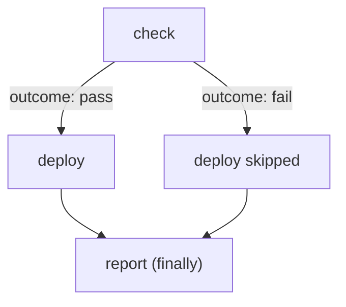

# Gate The Deploy With A when Expression

A check that only prints `fail` stops nothing. The deploy must read the result and refuse to run when the result is not `pass`. Tekton does this in a `Pipeline`, with ordering and a condition on each Task. This part builds the pipeline and runs it on the release that breaks the rules.

A **Pipeline** is an ordered set of Tasks. Each entry in `tasks` is a **Pipeline Task**: a reference to a Task plus the workspaces, parameters and conditions for this use. A **PipelineRun** is one execution of a Pipeline. Tekton creates one TaskRun for each Pipeline Task that runs.

## Order and condition

Two fields decide whether the `deploy` Pipeline Task runs. `runAfter` sets the order: the Task starts only after the named Tasks finish. Without it, Tekton starts Tasks with no dependency on each other at the same time. A **`when` expression** sets a condition. It has an `input`, an `operator` (`in` or `notin`) and a list of `values`. If the condition is false, Tekton skips the Pipeline Task.

The input of the condition is the result of the check: `$(tasks.check.results.outcome)`. Tekton also uses this reference to learn that `deploy` depends on `check`. Writing `runAfter` as well keeps the order visible to the reader.

The Pipeline also has a `finally` section. A **`finally` Task** runs after all other Tasks, whatever happened to them. The next part explains it in full. Here it only reports the outcome, and it needs a small Task to do so.

<!-- astrona:playground:renew -->

Save this as `task-report-outcome.yaml`:

```yaml
apiVersion: tekton.dev/v1
kind: Task
metadata:
  name: report-outcome
  namespace: pipelines
spec:
  description: Prints the status of the pipeline and of the check Task.
  params:
    - name: pipeline-status
    - name: check-status
  steps:
    - name: report
      image: curlimages/curl:8.22.0
      script: |
        #!/bin/sh
        echo "pipeline status: $(params.pipeline-status)"
        echo "check status:    $(params.check-status)"
```

Save this as `pipeline-release-gate.yaml`:

```yaml
apiVersion: tekton.dev/v1
kind: Pipeline
metadata:
  name: release-gate
  namespace: pipelines
spec:
  workspaces:
    - name: release
    - name: policies
  tasks:
    - name: check
      taskRef:
        name: check-release
      workspaces:
        - name: release
          workspace: release
        - name: policies
          workspace: policies
    - name: deploy
      runAfter: ["check"]
      when:
        - input: "$(tasks.check.results.outcome)"
          operator: in
          values: ["pass"]
      taskRef:
        name: deploy-release
      workspaces:
        - name: release
          workspace: release
  finally:
    - name: report
      taskRef:
        name: report-outcome
      params:
        - name: pipeline-status
          value: "$(tasks.status)"
        - name: check-status
          value: "$(tasks.check.status)"
```

Apply both:

```sh
kubectl apply -f task-report-outcome.yaml -f pipeline-release-gate.yaml
```

The Pipeline declares two workspaces and passes them on to the Tasks. It does not say where the files come from. The PipelineRun does that, so the same Pipeline can check any release.

## Run the pipeline on the release that breaks the rules

The PipelineRun below binds `release` to the `release-noncompliant` ConfigMap. It also sets `serviceAccountName`: every pod of the run uses the service account `pipeline-runner` to talk to the Kubernetes API.



The diagram shows that `report` runs on both paths, and `deploy` runs only when the check wrote `pass`.

Save this as `pipelinerun-noncompliant.yaml`:

```yaml
apiVersion: tekton.dev/v1
kind: PipelineRun
metadata:
  name: release-noncompliant-1
  namespace: pipelines
spec:
  pipelineRef:
    name: release-gate
  taskRunTemplate:
    serviceAccountName: pipeline-runner
  workspaces:
    - name: release
      configMap:
        name: release-noncompliant
    - name: policies
      configMap:
        name: platform-policies
```

Apply it and read the run after about 30 seconds. The second command shows that nothing reached the `starfleet` namespace:

```sh
kubectl apply -f pipelinerun-noncompliant.yaml
tkn -n pipelines pipelinerun describe release-noncompliant-1
kubectl -n starfleet get deploy
```

You should see something like this. The output of `kubectl apply` is left out:

```text
Name:              release-noncompliant-1
Namespace:         pipelines
Pipeline Ref:      release-gate
Service Account:   pipeline-runner
Labels:
 tekton.dev/pipeline=release-gate

Status

STARTED          DURATION   STATUS
30 seconds ago   11s        Succeeded

Timeouts
 Pipeline:   1h0m0s

Workspaces

 NAME       SUB PATH   WORKSPACE BINDING
 release    ---        ConfigMap (config=release-noncompliant)
 policies   ---        ConfigMap (config=platform-policies)

Taskruns

 NAME                            TASK NAME   STARTED          DURATION   STATUS
 release-noncompliant-1-report   report      24 seconds ago   5s         Succeeded
 release-noncompliant-1-check    check       30 seconds ago   6s         Succeeded

Skipped Tasks

 NAME
 deploy
No resources found in starfleet namespace.
```

The `check` and `report` Tasks ran. `deploy` has no TaskRun and appears under `Skipped Tasks`. The non-compliant release never reached the cluster. Note that the run is listed as `Succeeded`: a skipped Task is not a failure.

## Why the deploy was skipped

The PipelineRun object records the reason for each skipped Task. Read it, together with the reason and message of the run:

```sh
kubectl -n pipelines get pipelinerun release-noncompliant-1 -o jsonpath='{.status.skippedTasks}{"\n"}'
kubectl -n pipelines get pipelinerun release-noncompliant-1 -o jsonpath='{.status.conditions[0].reason}{"|"}{.status.conditions[0].message}{"\n"}'
```

You should see:

```text
[{"name":"deploy","reason":"When Expressions evaluated to false","whenExpressions":[{"input":"fail","operator":"in","values":["pass"]}]}]
Completed|Tasks Completed: 2 (Failed: 0, Cancelled 0), Skipped: 1
```

The first line shows the evaluated condition: the input was `fail`, and the condition needed `pass`. The second line shows that `kubectl` calls this run `Completed` while `tkn` calls it `Succeeded`. Both mean that no Task failed. Here the reason is `Completed` because one Task was skipped.

The gate works, and the `report` Task ran. The next question is what happens on the path where the check passes, and what `finally` guarantees on every path.

## Common pitfalls

> [!WARNING]
> - A `when` expression that is false skips the Task. It does not fail the pipeline. A script that only looks at the run status cannot tell that the gate blocked a release; read the skipped Tasks.
> - A `runAfter` alone never skips a Task. Without the `when` expression, `deploy` would run after a failed check result as well.
> - The `when` input is a string, compared with the values in the list. The check writes exactly `pass` or `fail`, and the expression asks for exactly `pass`.
> - A PipelineRun without `serviceAccountName` runs its pods with the `default` service account of the namespace, not with `pipeline-runner`.
