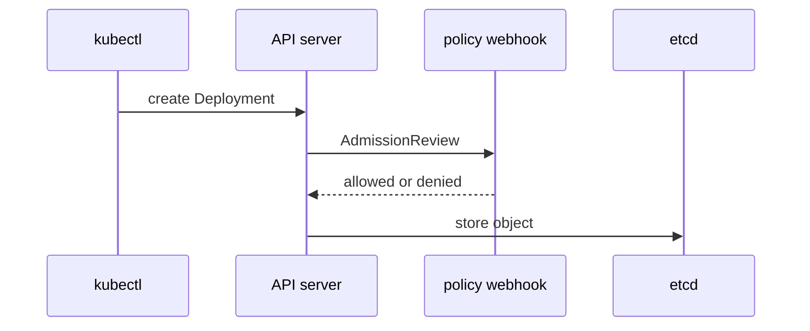

# Read An Image Reference

Before you write a rule about images, you need to know exactly what the rule can read. The API server does not pull the image and does not look inside it. It sees one string in the pod template. This part splits that string into its parts and shows that a cluster without an image policy admits every one of them.

A container **image reference** has up to three parts. The **registry** is the server that stores the image, such as `ghcr.io`. The **tag** is a name for one version, such as `6.15.0` or `latest`. The **digest** is the SHA-256 hash of the image manifest, written `@sha256:` followed by 64 hexadecimal characters. A reference without a registry, such as `nginx`, means `docker.io/library/nginx`. A reference without a tag means the tag `latest`.

## Tag and digest

A tag is a pointer that the owner of the repository can move. Today `ghcr.io/stefanprodan/podinfo:6.15.0` points at one image. If the owner pushes a different image under the same tag, the same reference points at different content. The tag `latest` is moved by design on every release.

A digest is computed from the content. If one byte of the manifest changes, the digest changes. The reference `ghcr.io/stefanprodan/podinfo@sha256:ec73780a8425f59ea49f5bc8cdff0d598805a224fbaa1f86c67a244f250fa9da` always points at the same image. The registry returned that value for the tag `6.15.0` in the `Docker-Content-Digest` header on 2026-11-02. Because the `podinfo` image runs on more than one CPU architecture, this digest names the image index, which lists one manifest per architecture.

A reference can hold both: `podinfo:6.15.0@sha256:...`. The container runtime then pulls by the digest, and the tag is only a label for people.

## What the API server sees

The path of a Deployment through the API server shows where an image policy sits.



The diagram shows that the webhook receives the whole object, including the image string, and answers before the API server stores anything. If the webhook denies the request, the object never reaches etcd.

<!-- astrona:playground:renew -->

The `scout` Deployment in `starfleet` runs from the preloaded image. Read its reference:

```sh
kubectl -n starfleet get deploy scout -o jsonpath='{.spec.template.spec.containers[0].image}{"\n"}'
```

You should see:

```text
ghcr.io/stefanprodan/podinfo:6.15.0
```

This reference has a registry (`ghcr.io`) and a tag (`6.15.0`). It has no digest.

## A cluster without a policy admits everything

The next command asks the API server whether it would accept a Deployment, without storing it. A server-side dry run (`--dry-run=server`) sends the request through authentication, authorization and all admission webhooks, and stops before the write to etcd. Paste this helper into your terminal:

```sh
try_image() {
  kubectl -n "$1" create deployment image-test --image="$2" --dry-run=server
}
```

Try an image with the `latest` tag and an image with no tag in the production namespace:

```sh
try_image starfleet-prod nginx:latest
try_image starfleet-prod nginx
```

Both requests pass:

```text
deployment.apps/image-test created (server dry run)
deployment.apps/image-test created (server dry run)
```

No admission controller looked at the image, so the cluster accepted a mutable tag from `docker.io` in a production namespace. The rest of the module closes this gap with rules about the registry, the tag and the digest. Each rule reads only the image string, so it cannot tell whether the image contains malware. It can only make sure that the string names a trusted registry and content that does not change.

The next question is how to write the first rule: allow images from one registry only.

## Common pitfalls

> [!WARNING]
> - A short name such as `nginx` is not "no registry". The container runtime pulls it from `docker.io`. A rule about registries must treat it as `docker.io`.
> - A reference without a tag is the same as `:latest`. A rule that only looks for the text `latest` lets it through.
> - A tag in a reference with a digest is ignored when the image is pulled. A reference can show `6.15.0` and run different content than the tag points at today.
> - A dry run proves what the API server would answer now. It does not prove that the pod can pull the image.
