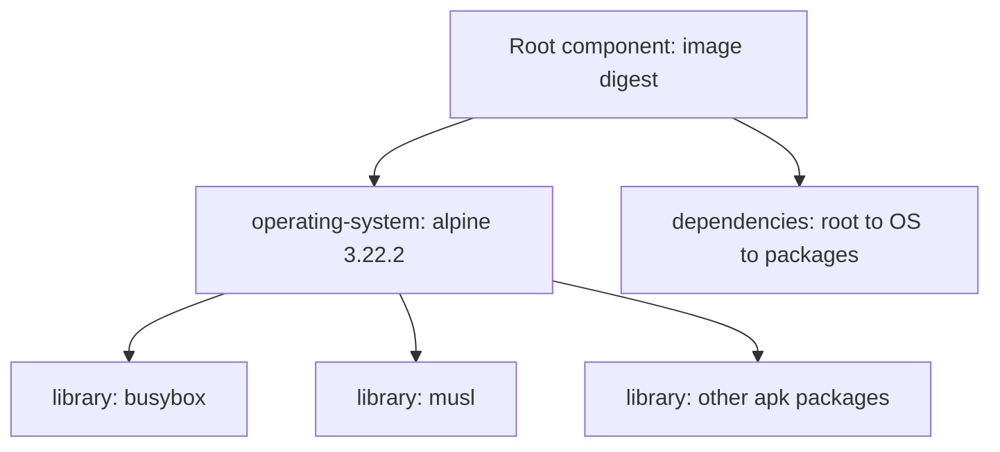

# Generate An SBOM As Audit Evidence

An auditor asks whether a package is inside the image running in `scout`. The Deployment's image tag cannot answer that question. A software bill of materials (SBOM) records the packages, their versions and their identifiers. Trivy can create that inventory without starting a container, and `jq`, a command-line processor for JavaScript Object Notation (JSON), can extract the answer.

A **digest** identifies immutable image content. A multi-platform image digest identifies an index whose entries point to architecture-specific images. Inspect the live reference and node architecture before choosing what to inventory.

<!-- astrona:playground:renew -->

```sh
kubectl -n starfleet get deployment scout -o jsonpath='{.spec.template.spec.containers[0].image}'
kubectl get nodes -L kubernetes.io/arch
mkdir -p /tmp/scout-evidence
```

Read the reference after the first command; the playground uses the digest below. Use the architecture from the node label: set `PLATFORM` to `linux/arm64` on an arm64 node, or `linux/amd64` on an amd64 node. Keep that choice for every inventory command. These examples use the immutable index reference and select a platform explicitly.

```sh
export PLATFORM=linux/arm64
export SCOUT_IMAGE=docker.io/library/alpine@sha256:4b7ce07002c69e8f3d704a9c5d6fd3053be500b7f1c69fc0d80990c2ad8dd412
trivy image --image-src remote --platform "$PLATFORM" --format cyclonedx --output /tmp/scout-evidence/scout.cdx.json "$SCOUT_IMAGE"
```

**CycloneDX** is a standard format for component inventories and their relationships. Trivy writes its JSON form with `bomFormat`, `specVersion`, a root image in `metadata.component`, and a `components` array. `--image-src remote` makes Trivy fetch the image from the registry rather than trying a local container engine; without the flag Trivy tries `docker`, `containerd` and `podman` sockets first and only then the registry. Creating this inventory does not need a vulnerability database; the CycloneDX format disables vulnerability scanning unless you add `--scanners vuln` explicitly.

Trivy builds the inventory in a fixed order. It fetches the manifest for the reference; for an index digest it selects the entry whose platform matches `--platform`, which is why the flag is required when the terminal and the node differ. It downloads that image's layers, detects the operating system from release files such as `/etc/alpine-release`, and reads the OS package database, `/lib/apk/db/installed` on Alpine, to list installed packages. Each package becomes a `library` component, the operating system becomes one `operating-system` component, and the image becomes the root component with a `pkg:oci/...` purl. Trivy adds its own `aquasecurity:trivy:*` properties to each component, for example the package type and the layer digest, and the `dependencies` array links the root to the operating system and the operating system to its packages.



The root carries the digest, the operating-system component carries the distribution, and every package hangs under it, so a package question is answered by walking down from the root rather than by searching free text.

Read the image identity, list the components, find `busybox`, and count the components:

```sh
jq '.metadata.component' /tmp/scout-evidence/scout.cdx.json
jq -r '.components[] | [.name,.version] | @tsv' /tmp/scout-evidence/scout.cdx.json
jq -r '.components[] | select(.name == "busybox") | .version' /tmp/scout-evidence/scout.cdx.json
jq '.components | length' /tmp/scout-evidence/scout.cdx.json
```

Look for the exact image reference in the root component and a nonempty version for `busybox`. The component count includes the one `operating-system` entry, so it is the package count plus one; it describes the inventory, not the number of vulnerabilities. A **package URL (purl)** identifies a package with its ecosystem and version. Use it when the same package name appears in different ecosystems. An SBOM describes what the tool could detect; it does not prove every embedded or copied library was identified.

## Keep a second standard format

**Software Package Data Exchange (SPDX)** is another standard for recording software packages and their relationships. Trivy's `spdx-json` format uses `packages`, with `versionInfo` for the version. Generate it from the same immutable image and platform:

```sh
trivy image --image-src remote --platform "$PLATFORM" --format spdx-json --output /tmp/scout-evidence/scout.spdx.json "$SCOUT_IMAGE"
jq -r '.packages[] | [.name,.versionInfo] | @tsv' /tmp/scout-evidence/scout.spdx.json
jq -r '.packages[] | select(.name == "busybox") | .versionInfo' /tmp/scout-evidence/scout.spdx.json
jq '.packages | length' /tmp/scout-evidence/scout.spdx.json
```

Look for `spdxVersion` in the document and the same installed `busybox` version. SPDX puts the image itself and the operating system into `packages` next to the apk packages and expresses the tree in `relationships` (`DESCRIBES` from the document to the image, `CONTAINS` from the image to the operating system and from the operating system to each package), whereas CycloneDX keeps the root outside `components`. The two `length` results therefore need not match. Keep the format and scanner version beside the evidence instead of treating both files as interchangeable lists.

Keep an index that tells the auditor which inventory belongs to which release. Save this as `configmap-scout-inventory.yaml`:

```yaml
apiVersion: v1
kind: ConfigMap
metadata:
  name: scout-inventory
  namespace: starfleet
data:
  image: "docker.io/library/alpine@sha256:4b7ce07002c69e8f3d704a9c5d6fd3053be500b7f1c69fc0d80990c2ad8dd412"
  format: CycloneDX
  scanner: Trivy-0.76.2
  evidence-file: /tmp/scout-evidence/scout.cdx.json
```

Apply it:

```sh
kubectl apply -f configmap-scout-inventory.yaml
```

Then check the result:

```sh
kubectl -n starfleet get configmap scout-inventory -o yaml
```

The ConfigMap stores an index, not the SBOM itself. The named file is on your terminal, so another user cannot retrieve it through that path from Kubernetes. A real pipeline copies the SBOM to retained artifact storage, indexed by digest and build identity. Copying the digest into a ConfigMap alone does not prove the file describes that digest; compare the file's root identity too.

You can now turn an image into an inventory in two formats and answer a package question from a saved file. Keeping that inventory makes a later scan possible even when the original build environment is gone. The next decision is which known vulnerabilities should prevent deployment.

## Common pitfalls

> [!WARNING]
> - **Scanning a tag after it moved.** Read the Deployment reference and retain the digest and platform with the evidence.
> - **Using `components` on SPDX JSON.** SPDX JSON uses `packages` and `versionInfo`.
> - **Calling an SBOM a clean security report.** An inventory says what was found inside the image. It is not a vulnerability verdict.
