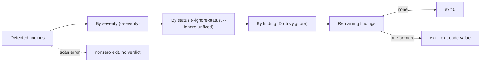

# Use Vulnerability Scan Exit Codes

A saved inventory tells an auditor which packages shipped. It does not tell a delivery pipeline whether to deploy. A vulnerability scanner compares those packages with known security issues. The pipeline must turn that changing list into a clear exit code and keep the report that explains the decision.

A **vulnerability** is a known security weakness. A **Common Vulnerabilities and Exposures (CVE)** identifier names a published weakness. Trivy downloads a vulnerability database that maps package versions to known issues. Even an unchanged image may have different findings tomorrow because the database changes.

Trivy stores that database in a `db` directory under its cache directory (`$HOME/.cache/trivy` on a Linux terminal unless `--cache-dir` points elsewhere) as `trivy.db` next to a `metadata.json` with `Version`, `UpdatedAt`, `NextUpdate` and `DownloadedAt`. A scan compares each package in the inventory against the advisories for its distribution and marks a finding with the installed version, the fixed version when the distribution has published one, and a status such as `fixed`, `affected` or `will_not_fix`.

<!-- astrona:playground:renew -->

The playground downloaded the database during bootstrap. Confirm which one the terminal holds before scanning:

```sh
trivy --version
```

Look for a `Vulnerability DB` block with `UpdatedAt` and `DownloadedAt` after the Trivy version line; those timestamps belong next to every verdict you keep. Then start with the live `scout` reference and the node architecture:

```sh
kubectl -n starfleet get deployment scout -o jsonpath='{.spec.template.spec.containers[0].image}'
kubectl get nodes -L kubernetes.io/arch
export PLATFORM=linux/arm64
export SCOUT_IMAGE=docker.io/library/alpine@sha256:4b7ce07002c69e8f3d704a9c5d6fd3053be500b7f1c69fc0d80990c2ad8dd412
trivy image --image-src remote --platform "$PLATFORM" --scanners vuln "$SCOUT_IMAGE"
echo $?
```

Change `PLATFORM` to `linux/amd64` if the node is amd64. Look at each finding's package name, installed version, fixed version and severity. `--scanners vuln` selects vulnerability scanning rather than secret or configuration checks. By default, findings do not make the exit code nonzero. A command can therefore list vulnerabilities and still let a pipeline proceed.

## Make findings affect the gate

The scan can write JavaScript Object Notation (JSON), a structured data format, for later queries. A **severity filter** selects the risk levels included in the report and decision. Choose `HIGH,CRITICAL` for this exercise and ask Trivy to exit with `1` when a matching finding remains:

```sh
trivy image --image-src remote --platform "$PLATFORM" --scanners vuln --severity HIGH,CRITICAL --exit-code 1 "$SCOUT_IMAGE"
echo $?
```

Read the exit code immediately: another command replaces `$?`. A completed scan returns zero if no selected findings remain, and the configured code if selected findings remain. Operational errors, such as a failed database download, can also return nonzero. The pipeline must stop on those errors too; an unreadable database is not a passing scan.

Trivy applies its filters in a fixed order, and only what survives the last filter reaches the exit-code decision:



Severity narrows first, status filters next, the ignore file last, so an identifier in `.trivyignore` is only consulted for findings that the two earlier filters kept, and a scan error short-circuits the whole chain with no verdict at all.

`--ignore-unfixed` is shorthand for `--ignore-status affected,will_not_fix,fix_deferred,end_of_life`: it removes every finding whose distribution has published no fix, whatever the reason. Run it with the same filter:

```sh
trivy image --image-src remote --platform "$PLATFORM" --scanners vuln --severity HIGH,CRITICAL --ignore-unfixed --exit-code 1 "$SCOUT_IMAGE"
echo $?
```

Compare the remaining findings with the earlier report. This flag can make a gate pass while unresolved vulnerabilities remain. It expresses a remediation policy, not a claim that the image is safe. Fix availability and severity come from advisory data, so keep the filter settings with the evidence.

## Scan the saved inventory

The CycloneDX software bill of materials (SBOM) you saved as `/tmp/scout-evidence/scout.cdx.json` is the inventory a pipeline retains separately from the build. Scan that file instead of the registry, and keep the report as JSON:

```sh
trivy sbom --severity HIGH,CRITICAL --exit-code 1 --format json --output /tmp/scout-evidence/scan.json /tmp/scout-evidence/scout.cdx.json
echo $?
jq -r '.Results[]? | .Vulnerabilities[]? | [.VulnerabilityID,.PkgName,.InstalledVersion,.FixedVersion,.Severity] | @tsv' /tmp/scout-evidence/scan.json
```

Trivy detects the SBOM format from the file. The `sbom` subcommand runs only the `vuln` scanner by default, so no `--scanners` flag is needed, and it needs no registry access: it reads the operating system and package list from the file and evaluates them with its current database. A Trivy-generated SBOM carries `aquasecurity:trivy:*` properties that tell Trivy the operating system and package types; an SBOM from another tool lacks them, and Trivy documents that scanning such a file may detect vulnerabilities inaccurately. The saved inventory is stable, but a later scan is a new assessment with new advisory data. The report's `Results[].Vulnerabilities[]` entries are the findings that survived the filters, each with the same fields the table showed.

## Record a narrow exception

An **ignore file** lists findings excluded by policy. Choose one CVE identifier that actually appears in your report. If there are none, keep the file empty and observe that the decision stays the same. Save this as `.trivyignore`, replacing the placeholder with your chosen identifier or removing the line:

```text
# Approved exception: record its owner, reason and review date here.
<CVE-ID-FROM-YOUR-REPORT>
```

Apply it to the next scan:

```sh
trivy sbom --severity HIGH,CRITICAL --ignorefile .trivyignore --exit-code 1 /tmp/scout-evidence/scout.cdx.json
echo $?
```

The explicit `--ignorefile` makes the chosen file clear; Trivy otherwise looks for `.trivyignore` in the current directory. Each non-comment line is one identifier, and an identifier may carry an expiry in the form `CVE-2019-14697 exp:2023-01-01`: after that date Trivy stops ignoring the finding, so an exception with a review date enforces its own review. Severity selection, status selection and ignores all affect the findings that reach the exit-code decision, in that order. An ignored identifier may hide a finding on several packages. Review exceptions as code, and keep the ignore file with the scan evidence.

You can now gate on a process exit code instead of searching console text. Retain the image digest, platform, SBOM, scanner version, scan time, database metadata, options and ignore file to explain that verdict later. A successful scan is a statement about those inputs at that time.

## Common pitfalls

> [!WARNING]
> - **Using the default exit code in a gate.** Without `--exit-code`, findings alone do not fail the command.
> - **Treating `--ignore-unfixed` as a fix.** It filters findings; it changes no package.
> - **Expecting old and new reports to match.** Database updates can change results for the same inventory.
> - **Continuing after a download error.** No usable scan means no passing security decision.
