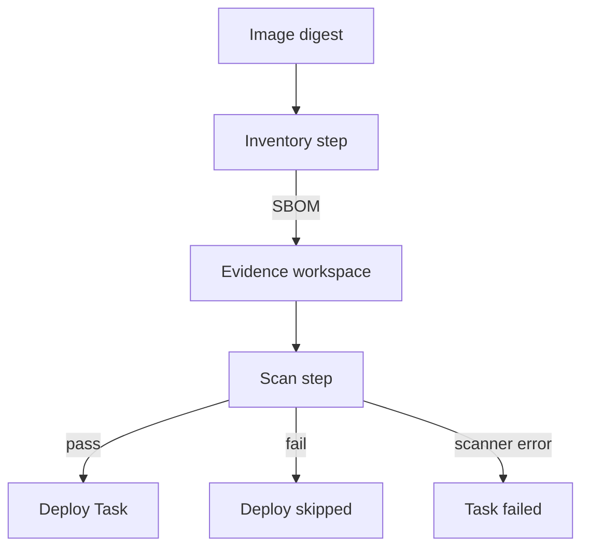
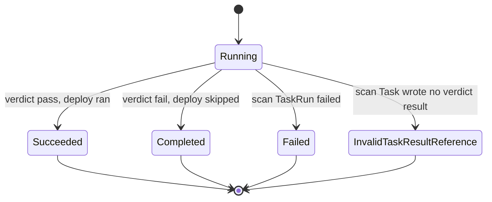

# Keep SBOM Evidence In A Tekton Pipeline

A pipeline that only prints a scan loses the package inventory when its pod is removed. A software bill of materials (SBOM) must be written to retained storage, and deployment must read the scan decision for that same image. Add an inventory Task to the check-and-deploy pattern so the evidence and the gate share one immutable input.

A Tekton **Task** runs ordered container steps. A **result** exports a small value to the Pipeline, while a **workspace** mounts files into its Tasks. The playground has a `deploy-inventory` Task and a `pipeline-runner` service account that can patch only `scout` in `starfleet`. The scanner needs registry access, not permission to create Kubernetes objects.

<!-- astrona:playground:renew -->

Save this as `task-scan-inventory.yaml`:

```yaml
apiVersion: tekton.dev/v1
kind: Task
metadata:
  name: scan-inventory
  namespace: pipelines
spec:
  params:
    - name: image
      type: string
    - name: platform
      type: string
    - name: evidence-directory
      type: string
  workspaces:
    - name: evidence
  results:
    - name: verdict
      description: pass or fail after a completed scan
  steps:
    - name: inventory
      image: aquasec/trivy:0.76.2
      env:
        - name: IMAGE
          value: $(params.image)
        - name: PLATFORM
          value: $(params.platform)
        - name: EVIDENCE
          value: $(workspaces.evidence.path)/$(params.evidence-directory)
      script: |
        #!/bin/sh
        set -eu
        mkdir -p "$EVIDENCE"
        printf '%s\n' "$IMAGE" > "$EVIDENCE/image.txt"
        printf '%s\n' "$PLATFORM" > "$EVIDENCE/platform.txt"
        trivy --version > "$EVIDENCE/scanner.txt"
        trivy image --image-src remote --platform "$PLATFORM" \
          --format cyclonedx --output "$EVIDENCE/sbom.cdx.json" "$IMAGE"
    - name: scan
      image: aquasec/trivy:0.76.2
      env:
        - name: EVIDENCE
          value: $(workspaces.evidence.path)/$(params.evidence-directory)
      script: |
        #!/bin/sh
        set -eu
        trivy image --cache-dir "$EVIDENCE/cache" --download-db-only
        cp "$EVIDENCE/cache/db/metadata.json" "$EVIDENCE/database.json"
        date -u +%FT%TZ > "$EVIDENCE/scanned-at.txt"
        printf '%s\n' 'severity=HIGH,CRITICAL; exit-code=42; no ignores' > "$EVIDENCE/options.txt"
        if trivy sbom --cache-dir "$EVIDENCE/cache" --skip-db-update \
          --severity HIGH,CRITICAL --exit-code 42 --format json \
          --output "$EVIDENCE/scan.json" "$EVIDENCE/sbom.cdx.json"; then
          printf pass > "$(results.verdict.path)"
        else
          scan_status=$?
          printf fail > "$(results.verdict.path)"
          if [ "$scan_status" -ne 42 ]; then
            exit "$scan_status"
          fi
        fi
```

Apply it:

```sh
kubectl apply -f task-scan-inventory.yaml
```

The first step creates the inventory. Steps share the mounted workspace even though their container filesystems differ. The second step downloads a database, copies its metadata, then scans with that database using `--skip-db-update`. That flag does not make an absent database usable. It keeps the scan and saved database metadata aligned for this run.

A selected vulnerability returns `42`. The script writes `fail` but lets the Task complete, so the Pipeline can evaluate its `when` expression. A scanner error writes `fail` and also fails the Task. An inventory failure stops the Task before the scan. All three paths prevent deployment. A passing scan writes `pass` to the Tekton result path; writing to a similarly named workspace file would not export a result. Underneath, `$(results.verdict.path)` is a file under `/tekton/results/`, and Tekton copies its content into the step container's termination message when the step exits, which is why a result must stay small and why a step that is killed before it exits leaves no result.

## Connect the verdict to deployment

Save this as `pipeline-sbom-release.yaml`. Replace `linux/arm64` with `linux/amd64` if that is your node architecture; `kubectl get nodes -L kubernetes.io/arch` shows it. The image parameter goes to both Tasks, so deployment cannot silently use a different tag.

```yaml
apiVersion: tekton.dev/v1
kind: Pipeline
metadata:
  name: sbom-release
  namespace: pipelines
spec:
  params:
    - name: image
      type: string
    - name: platform
      type: string
  workspaces:
    - name: evidence
  tasks:
    - name: scan
      taskRef:
        name: scan-inventory
      params:
        - name: image
          value: $(params.image)
        - name: platform
          value: $(params.platform)
        - name: evidence-directory
          value: $(context.pipelineRun.name)
      workspaces:
        - name: evidence
          workspace: evidence
    - name: deploy
      taskRef:
        name: deploy-inventory
      params:
        - name: image
          value: $(params.image)
      when:
        - input: $(tasks.scan.results.verdict)
          operator: in
          values: [pass]
---
apiVersion: tekton.dev/v1
kind: PipelineRun
metadata:
  generateName: sbom-release-
  namespace: pipelines
spec:
  pipelineRef:
    name: sbom-release
  taskRunTemplate:
    serviceAccountName: pipeline-runner
  params:
    - name: image
      value: docker.io/library/alpine@sha256:4b7ce07002c69e8f3d704a9c5d6fd3053be500b7f1c69fc0d80990c2ad8dd412
    - name: platform
      value: linux/arm64
  workspaces:
    - name: evidence
      persistentVolumeClaim:
        claimName: sbom-evidence
```

Apply it by creating the two objects; `generateName` asks the API server for a new run name:

```sh
kubectl create -f pipeline-sbom-release.yaml
```

The result reference creates the ordering dependency. `runAfter` alone could wait for the scan, but it could not select `pass`. A completed scan with a `fail` result skips deployment. A scanner error fails the run rather than granting an exception. The existing pattern's `finally` reporting can be added unchanged; it must not write a passing result on behalf of a failed scanner.



The scan step publishes the decision, and Tekton evaluates the condition before starting the deploy Task.

## Read the decision and retain the files

Inspect the live run, then the associated TaskRuns and their step termination information:

```sh
kubectl -n pipelines get pipelineruns
kubectl -n pipelines get pipelineruns -o json | jq '.items[] | {name:.metadata.name,conditions:.status.conditions,skipped:.status.skippedTasks}'
kubectl -n pipelines get taskruns -o json | jq '.items[] | {name:.metadata.name,results:.status.results,steps:.status.steps}'
kubectl -n pipelines exec evidence-reader -- find /evidence -maxdepth 2 -type f
kubectl -n pipelines cp evidence-reader:/evidence ./sbom-evidence
```

Look for `verdict` in TaskRun results and the deploy entry in `skippedTasks` when the verdict is `fail`. For a Task failure, read `status.conditions` and each step's terminated reason and exit code. A result of `fail` is distinct from a Task that failed to produce any result.

The PipelineRun's `Succeeded` condition tells the three outcomes apart by its `reason`:



`Succeeded` means status `True` with no skipped Task, `Completed` means status `True` with at least one entry in `skippedTasks`, `Failed` means status `False` because a TaskRun failed, and a missing `verdict` result makes the consuming `when` expression unresolvable so the run fails with `InvalidTaskResultReference`. A gate that only checks for status `True` would therefore treat a skipped deploy as a release.

The PVC keeps one evidence directory per PipelineRun name after its Task pod finishes. The reader pod makes those files accessible with `kubectl cp`. This storage is still part of the playground cluster. Copy the evidence before destroying it; a production pipeline uploads the run directory to artifact storage with access controls and a retention period. Do not store the entire SBOM in a Task result or assume Task logs preserve it.

You now have a scan decision connected to both an image digest and retained evidence. Admission still needs its own check because callers can bypass a pipeline. A trusted image signature gives the admission controller a separate fact to verify.

## Common pitfalls

> [!WARNING]
> - **Writing every run to the same file.** Concurrent runs can mix one image's inventory with another run's decision. Use a directory named for the run.
> - **Using `|| true` without recording the status.** That can turn scanner errors into passing releases.
> - **Gating on a report string.** Gate on the result derived from the scanner exit code; keep the report as evidence.
> - **Keeping evidence only in the pod.** Mount retained storage and copy it outside the cluster before cleanup.
