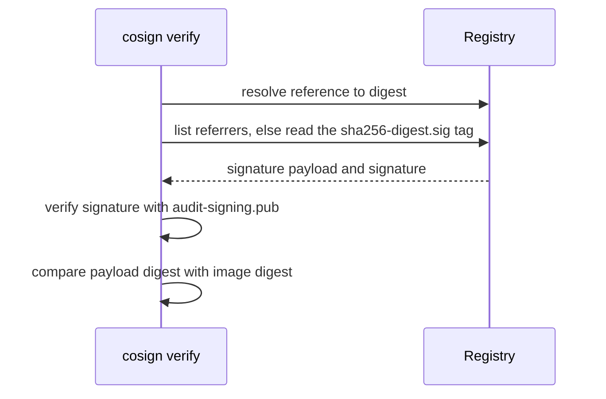
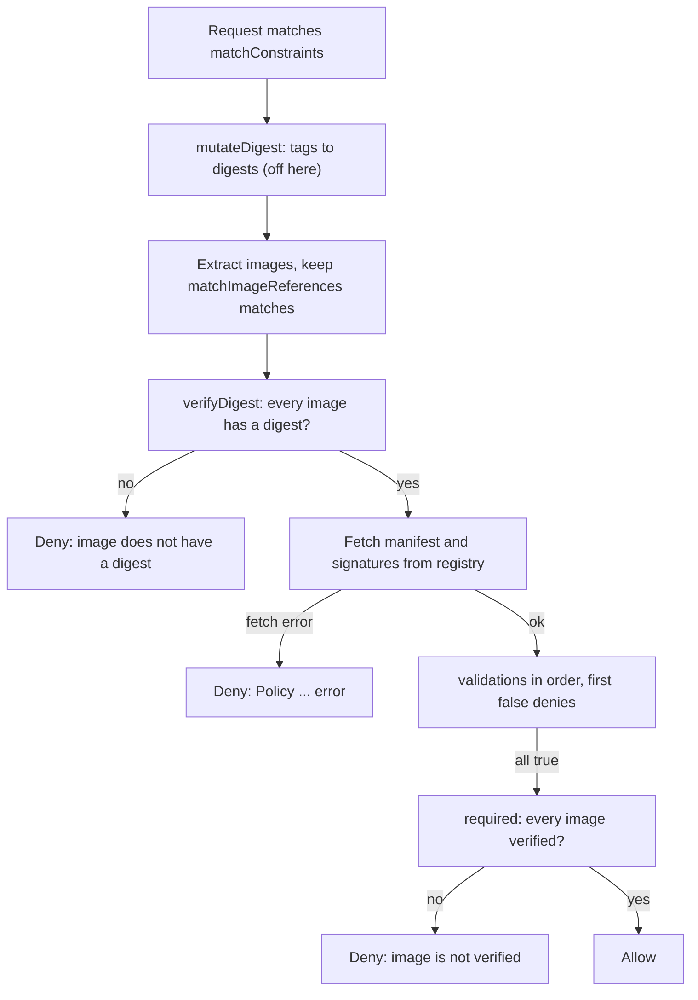

# Verify Signatures Before Admission

An approved registry can contain an image uploaded by the wrong publisher. A digest identifies content but does not identify who approved it. An **image signature** binds an image digest to a signing key. Verification checks that binding with a trusted public key, while the private key stays with the signer.

The playground provides a public key for a published test image. It is a teaching fixture, not a production trust authority. The signed and unsigned references below are pinned by digest. Verification reads registry metadata and signatures; it does not run either image.

<!-- astrona:playground:renew -->

```sh
cosign verify --key /tmp/ats021-050-03-keys/audit-signing.pub --insecure-ignore-tlog ghcr.io/kyverno/test-verify-image@sha256:b31bfb4d0213f254d361e0079deaaebefa4f82ba7aa76ef82e90b4935ad5b105
echo $?
cosign verify --key /tmp/ats021-050-03-keys/audit-signing.pub --insecure-ignore-tlog ghcr.io/kyverno/test-verify-image@sha256:74a98f0e4d750c9052f092a7f7a72de7b20f94f176a490088f7a744c76c53ea5
echo $?
```

Look for a verified payload for the signed reference and a nonzero status for the unsigned reference. cosign checks the signature and the image digest claim. Trust the public key only if it came through an approved channel; downloading a key from the same untrusted source as an image would not establish who published it.

`cosign verify` does four things in order. It resolves the reference to a digest. It asks the registry for signature bundles attached to that digest as OCI referrers; when there are none, it falls back to the older layout and reads the tag `sha256-<digest>.sig` in the same repository. It checks each signature against the public key. Finally, because `--check-claims` is on by default, it reads the signed payload and requires that the digest recorded inside it equals the digest of the image being verified, so a valid signature copied from another image is rejected. The unsigned fixture fails at the second step: there is no bundle and no `.sig` tag, so cosign reports no matching signatures and exits nonzero.



Every fact cosign uses comes from the registry except the key, so the key is the only input the verifier must obtain through a channel it trusts.

This fixture was signed without a transparency-log requirement. `--insecure-ignore-tlog` skips that check for this fixture only. A **transparency log** records signing events so others can inspect them. Public production signing should retain transparency verification; skipping it changes the trust guarantee. A valid signature also says nothing about whether the image has known vulnerabilities. Scanning and signing answer different questions.

## Require verification at admission

Kyverno's `ImageValidatingPolicy` verifies image signatures as the API server handles a request. Kyverno 1.19.1 serves `policies.kyverno.io/v1` for this kind. A policy declares its resource scope, its image scope, its trusted **attestor** (the key or identity allowed to sign), and a Common Expression Language (CEL) validation that requires a verified signature.

Save this as `imagevalidatingpolicy-signed-starfleet.yaml`:

```yaml
apiVersion: policies.kyverno.io/v1
kind: ImageValidatingPolicy
metadata:
  name: signed-starfleet
spec:
  evaluation:
    background:
      enabled: false
  webhookConfiguration:
    timeoutSeconds: 30
  failurePolicy: Fail
  validationActions: [Deny]
  matchConstraints:
    namespaceSelector:
      matchLabels:
        kubernetes.io/metadata.name: starfleet
    resourceRules:
      - apiGroups: [""]
        apiVersions: [v1]
        operations: [CREATE, UPDATE]
        resources: [pods, pods/ephemeralcontainers]
  matchImageReferences:
    - glob: "*"
  validationConfigurations:
    mutateDigest: false
    verifyDigest: true
    required: true
  attestors:
    - name: auditKey
      cosign:
        key:
          data: |
              -----BEGIN PUBLIC KEY-----
              MFkwEwYHKoZIzj0CAQYIKoZIzj0DAQcDQgAE8nXRh950IZbRj8Ra/N9sbqOPZrfM
              5/KAQN0/KjHcorm/J5yctVd7iEcnessRQjU917hmKO6JWVGHpDguIyakZA==
              -----END PUBLIC KEY-----
        ctlog:
          insecureIgnoreTlog: true
  validations:
    - expression: >-
        (images.containers + images.initContainers + images.ephemeralContainers).map(image,
          verifyImageSignatures(image, [attestors.auditKey])).all(count, count > 0)
      message: Every image must have a signature from the approved key.
```

Apply it:

```sh
kubectl apply -f imagevalidatingpolicy-signed-starfleet.yaml
```

Then check the result:

```sh
kubectl get imagevalidatingpolicy signed-starfleet -o yaml
kubectl -n kyverno get deployments
```

Read `status.conditionStatus.ready` and `status.conditionStatus.conditions` for policy readiness before testing admission. The namespace selector restricts the rule to `starfleet`. The image glob `*` selects every image there. A narrow glob for only the trusted repository would leave other repositories outside this signature requirement. Additional registry restrictions can be enforced separately.

Kyverno extracts regular, init and ephemeral container images into separate lists (`images.containers`, `images.initContainers`, `images.ephemeralContainers`). The expression joins those lists, checks their digests and obtains their signatures from the registry. The explicit `pods/ephemeralcontainers` resource also covers requests that add debug containers; a `pods` match alone does not cover that subresource. `verifyImageSignatures` returns the number of attestors in the list whose verification succeeded, and `0` for an image that `matchImageReferences` did not select; `all` requires a positive count for each extracted image. `required` also requires image verification, while `verifyDigest` requires digest references. `mutateDigest: false` leaves tag references unchanged so the digest requirement can reject them. `Deny` rejects a failed validation and an evaluation error alike, and `failurePolicy: Fail` makes the API server refuse the request when the webhook gives no answer at all.

The admission controller evaluates the policy in a fixed order for each matching request:



The digest check and the registry fetch happen before any `validations` expression runs, so a tag reference or an unreachable registry is refused with its own message rather than with the `message` of the expression.

Each stage has its own failure text. A tag reference fails `verifyDigest` with `image <reference> does not have a digest`. A validation that evaluates to `false` is reported as `Policy signed-starfleet failed:` followed by its `message`, or by `CEL expression validation failed at index N` when none is set. An image that no validation verified fails the `required` check with `image <reference> is not verified: no policy performed a signature or attestation check on it`. A registry error is an evaluation error, not a `false` validation; under `Deny` it is still refused, as `Policy signed-starfleet error:` followed by the error. `failurePolicy` governs a different case: the API server applies it when the webhook itself does not answer, for example when `timeoutSeconds` expires or the admission controller is down. `Fail` rejects the request then; `Ignore` would admit it unverified.

The policy repeats the fixture's transparency exception with `insecureIgnoreTlog`. That is separate from `failurePolicy`: allowing a missing log entry does not allow an invalid signature or a registry failure. Replace the fixture key and transparency settings with the platform's trust configuration before using this policy outside the exercise.

## Prove both admission decisions

Send two Pod requests with server-side dry runs. A dry run executes admission without storing the object or pulling its image onto a node:

```sh
kubectl -n starfleet run signed-check --image=ghcr.io/kyverno/test-verify-image@sha256:b31bfb4d0213f254d361e0079deaaebefa4f82ba7aa76ef82e90b4935ad5b105 --overrides='{"spec":{"serviceAccountName":"scout"}}' --dry-run=server
kubectl -n starfleet run unsigned-check --image=ghcr.io/kyverno/test-verify-image@sha256:74a98f0e4d750c9052f092a7f7a72de7b20f94f176a490088f7a744c76c53ea5 --overrides='{"spec":{"serviceAccountName":"scout"}}' --dry-run=server
```

Look for acceptance of the signed image and, for the unsigned image, a rejection that carries `Policy signed-starfleet failed:` and the validation `message`. If both fail, read the webhook message before changing enforcement: `failed:` with the message means the expression returned `false`, `error:` means Kyverno could not evaluate it, and `does not have a digest` means the reference was a tag. A registry timeout or unavailable signature artifact is an operational failure, not proof of an unsigned image. Inspect controller logs to distinguish them:

```sh
kubectl -n kyverno logs deployment/kyverno-admission-controller --all-containers --tail=80
kubectl -n starfleet get events --sort-by=.metadata.creationTimestamp
```

Admission failures can appear directly in the API server response without a stored Event for the rejected object. A Deployment whose child Pod is refused can instead show a ReplicaSet `FailedCreate` event. This example matches Pod admission; Kyverno can generate controller rules for pod templates. Inspect the policy's `status.autogen` to see generated rules rather than assuming which request was checked. Existing running Pods are not evicted by this policy. A later rollout must pass admission.

The verification command and admission policy now use the same public key and immutable image identity. The pipeline retains inventory and scan evidence, and Kyverno independently requires a trusted signature when a workload enters the cluster. Keep those checks separate so a passing inventory scan never stands in for publisher identity.

## Common pitfalls

> [!WARNING]
> - **Trusting a digest as a signature.** The digest proves content identity; a trusted key establishes the signer.
> - **Selecting only the approved image repository.** Other images may escape the signature check. Match every image in the protected scope.
> - **Using `Audit` when deployment must stop.** `Deny` enforces the validation and its evaluation errors; `failurePolicy: Fail` covers a webhook that never answers.
> - **Treating an old Pod as an admission test.** Send a new request and inspect the API server's answer.

## Your mission: Verify Image Signatures At Admission

You can now verify an image with a public key and require that key at admission. The mission asks you to record two verification results and protect namespaces labelled for production while preserving admission elsewhere.

Pause the playground, then start the lab:

```sh
astrona stop ats-021-playground-050-03
astrona run --git ssh://git@github.com/astrona-io/ATS021.git -c sections/section-050/module-03/labs/lab-03
```

When your policy is ready, grade it once:

```sh
astrona submit --git ssh://git@github.com/astrona-io/ATS021.git -c sections/section-050/module-03/labs/lab-03
```

Then remove the lab and resume the playground:

```sh
astrona destroy ats-021-lab-050-03-03
astrona start ats-021-playground-050-03
```
